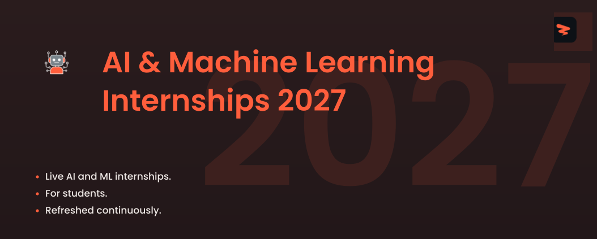

<!-- Cover -->

# AI & Machine Learning Internships 2027

🚀 Live AI, machine learning, and data science internships for students, refreshed through the Zapply job pipeline.

  
  
  
  

---

## **Website & Autofill Extension**

Explore Zapply's website and check out:

- Our Chrome extension, which autofills job applications in seconds.
- A dedicated job board featuring the latest openings across various roles.
- User accounts with multiple profiles for different resume types and roles.
- Job application tracking with streaks and commitment awards.

Experience an advanced career journey with us! 🚀

  

## Explore Around

Connect and seek advice from a growing network of fellow students and new grads.

  
  &nbsp;&nbsp;
  

---

 

<h3>🤖 <strong>Machine Learning & AI Engineering</strong></h3>

| Company | Role | Location | Posted | Visa | **Apply** |
|---------|------|----------|--------|------|----------|
| **Microsoft** | Research Intern - Machine Learning for Biology and Healthcare | Redmond, Washington, United States | 20h | ✅ Sponsor |  |
| **NVIDIA** | NVIDIA 2027 Internships: Deep Learning | US, CA, Santa Clara | 1d | ✅ Sponsor |  |
| **NVIDIA** | NVIDIA 2027 Internships: Deep Learning Computer Architecture | US, CA, Santa Clara | 1d | ✅ Sponsor |  |
| **NVIDIA** | Finance AI Engineering Intern - Summer 2027 | US, CA, Santa Clara | 1d | ✅ Sponsor |  |
| **Generac** | Intern AI Engineering | Waukesha, WI - USA | 1d | ✅ Sponsor |  |
| **Marvell** | Applied AI/ML Research Scientist Intern | Santa Clara, CA | 1d | ✅ Sponsor |  |
| **Crowe** | Machine Learning Intern | Chicago, IL | 1d |  |  |
| **Samsung Semiconductor** | Intern, LLM Inference Acceleration Architecture (MoE & Attention–FFN Disaggregation) | San Jose, California, United States | 1d | ✅ Sponsor |  |
| **Microsoft** | Research Intern - AI Systems Architecture and Efficient LLM Inference | Redmond, Washington, United States | 1d | ✅ Sponsor |  |
| **Samsung Research America Internship** | 2027 Spring/Summer Intern, Computer Vision | 665 Clyde Avenue, Mountain... | 2d |  |  |
| **ASML** | Internship/Co-Op: AI Engineer | San Jose, CA, USA | 3d | ✅ Sponsor |  |
| **ASML** | Internship/Co-Op: AI Engineer | San Diego, CA, USA | 3d | ✅ Sponsor |  |
| **Adobe** | 2027 Intern - Applied and Research Scientist/Engineer | San Jose | 3d | ✅ Sponsor |  |
| **Aerospace Corporation** | 2027 Machine Learning Engineer Undergrad Intern | El Segundo, CA | 3d |  |  |
| **MITRE** | AI Engineering Intern | Bedford, Massachusetts | 3d |  |  |
| **Microsoft** | Research Intern - AI /Machine Learning Numerics & Efficiency | Mountain View, California,... | 5d | ✅ Sponsor |  |
| **Chan Zuckerberg Biohub** | AI Research Scientist Intern | New York, NY (Hybrid) | 6d | ✅ Sponsor |  |
| **T-Mobile** | Summer 2027 AI Engineering Internship - Site Reliability & Automation | Atlanta, Georgia | 6d | ✅ Sponsor |  |
| **LinkedIn** | AI/ML Engineer Intern, Master's - Summer 2027 (Mountain View, CA) | Mountain View, CA | 6d | ✅ Sponsor |  |
| **LinkedIn** | AI/ML Engineer Intern – Generative AI, PhD – Summer 2027 (Mountain View, CA) | Mountain View, CA | 6d | ✅ Sponsor |  |
| **LinkedIn** | AI/ML Engineer Intern – Search and Recommender Systems, PhD – Summer 2027 (Mountain View, CA) | Mountain View, CA | 6d | ✅ Sponsor |  |
| **Lucid Motors** | Intern, AI & Data (Applied AI/Machine Learning), Summer 2027 | Newark, CA | 6d | ✅ Sponsor |  |
| **HPE (University)** | AI Engineering Technical Intern | Sunnyvale, California | 1w | ✅ Sponsor |  |
| **Northrop Grumman** | 2027 AI/ML Engineering Intern - Morrisville NC | United States-North... | 1w |  |  |
| **Samsung Semiconductor** | Intern, LLM Inference Acceleration Architecture (Distributed Memory-Centric Accelerators) | San Jose, California, United States | 1w | ✅ Sponsor |  |
| **ICF** | 2027 Summer Intern, AI Engineer (Master's Degree, Reston, VA) | Reston, VA | 1w |  |  |
| **State Street** | Agentic AI Engineering, Technology Intern - Full-time Internship (Jan - June 2027) | Burlington Massachusetts | 1w | ✅ Sponsor |  |
| **State Street** | Agentic AI Engineering, Technology Intern - Full-time Internship (Jan - June 2027) | Burlington Massachusetts | 1w | ✅ Sponsor |  |
| **State Street** | AI Engineering Intern - Full-time Internship (Jan - June 2027) | Cambridge, Massachusetts | 1w | ✅ Sponsor |  |
| **Zillow** | Applied Scientist (Economics) Intern | Seattle-WA | 1w | ✅ Sponsor |  |
| **Aerospace Corporation** | 2027 Machine Learning Engineering Graduate Intern | El Segundo, CA | 1w |  |  |
| **Bose** | Data Science Co-Op (NLP & GenAI) | MA Framingham | 1w | ✅ Sponsor |  |
| **Anduril** | 2027 Machine Learning Engineer Intern | Santa Ana, California, United... | 1w |  |  |
| **KLA** | Computer Vision/Machine Learning Intern | Milpitas, CA | 1w | ✅ Sponsor |  |
| **T-Mobile** | Summer 2027 AI Engineering Internship | Bellevue, Washington | 1w | ✅ Sponsor |  |
| **Toyota Research Institute** | Robotics Intern, World Models, Multimodal Sensing | Cambridge, MA | 1w | ✅ Sponsor |  |
| **Entegris** | Research Scientist Intern - Summer 2027 | Aurora, IL | 1w | ✅ Sponsor |  |
| **ASML** | Internship - Integrate GUI and LLM | San Jose, CA, USA | 1w | ✅ Sponsor |  |
| **Carnegie Mellon SEI** | AI Engineer Intern - Mission Innovation Lab (Summer 2027) | Pittsburgh, PA | 1w |  |  |
| **Toyota Research Institute** | Automated Driving Advanced Development Intern, Machine Learning Research (Cambridge) | Cambridge, MA | 1w | ✅ Sponsor |  |
| **Carnegie Mellon University** | AI Engineer Intern - Mission Innovation Lab (Summer 2027) | Pittsburgh, PA | 1w | ✅ Sponsor |  |
| **Postman** | AI Engineer, Intern | San Francisco, CA, US | 1w | ✅ Sponsor |  |
| **Micron Technology** | Intern -  AI Engineer Platform | Boise, ID - Main Site | 1w | ✅ Sponsor |  |
| **Amazon.com Services LLC** | 2027 Applied Science Internship - Robotics - United States | North Reading, MA | 1w | ✅ Sponsor |  |
| **Micron** | Intern -  AI Engineer Platform | Boise, Idaho, United States of... | 1w |  |  |
| **BAE Systems** | AI/ML Engineer Intern, Summer 2027 | Rockville, Maryland | 1w |  |  |
| **Symbotic** | Intern- PhD Applied Scientist, Robotics Planning | USA Wilmington,  MA - | 2w | ✅ Sponsor |  |
| **ServiceNow** | Assoc AI Engineering (Cloud Security Automation) Intern | Santa Clara, CALIFORNIA | 2w | ✅ Sponsor |  |
| **Samsung Semiconductor** | Intern, AI System Architecture Research Scientist | San Jose, California, United States | 2w | ✅ Sponsor |  |
| **Bose** | Agentic AI Engineering Co-op – Active Noise Cancellation   Fall 2027 | US, MA - Framingham | 2w | ✅ Sponsor |  |
| **Toyota Research Institute** | Automated Driving Advanced Development Intern, Machine Learning Research | Los Altos, CA | 2w | ✅ Sponsor |  |
| **Riot Games** | Machine Learning Engineering Intern (Masters/PhD) - Summer 2027 | Los Angeles, USA | 2w | ✅ Sponsor |  |
| **General Motors** | 2027 Summer Intern - Machine Learning Engineer, Embodied AI | Sunnyvale, California, United... | 2w | ✅ Sponsor |  |
| **General Motors** | 2027 Summer Intern – Machine Learning Engineer, AV/AI Platform | Sunnyvale, California, United... | 2w | ✅ Sponsor |  |
| **Analog Devices** | Machine Learning for Computational Sensing Research Intern | US, MA, Boston | 2w | ✅ Sponsor |  |
| **NBCUniversal** | Media Tech: Data, AI & Machine Learning Internships – Summer 2027 | Universal City, CA | 2w | ✅ Sponsor |  |
| **NBCUniversal** | Media Tech: Data, AI & Machine Learning Internships – Summer 2027 | New York, NY | 2w | ✅ Sponsor |  |
| **CACI** | AI/ML Engineering Co-op - Spring 2027 | King of Prussia, PA, US | 2w | ✅ Sponsor |  |
| **Zoox** | AI Engineering Intern, Operational Safety \[Summer 2027\] | Foster City, CA | 2w | ✅ Sponsor |  |
| **Parspec** | Applied AI Engineer Intern | Hybrid - San Mateo, California | 2w |  |  |
| **Waymo** | 2027 Summer Intern, PhD, Machine Learning - Generative World Models & Controllable Simulation | Mountain View, California,... | 2w | ✅ Sponsor |  |
| **Waymo** | 2027 Summer Intern, Machine Learning, MS/PhD, Simulation Realism (World Model) | Mountain View, California,... | 2w | ✅ Sponsor |  |
| **Match Group** | Machine Learning Engineer Intern | Palo Alto, California | 2w |  |  |
| **ICD** | Summer 2027 AI/ML Engineering Internship | Jersey City, NJ, United States | 2w |  |  |
| **Tradeweb** | Summer 2027 AI/ML Engineering Internship | Jersey City, NJ, United States | 2w |  |  |
| **PayPal** | Machine Learning Engineer Intern - Summer 2027 | San Jose, California, United... | 3w | ✅ Sponsor |  |
| **PayPal** | Machine Learning Engineer PhD Intern - Summer 2027 | San Jose, California, United... | 3w | ✅ Sponsor |  |
| **Thomson Reuters** | Research Scientist Intern | MN | 3w | ✅ Sponsor |  |
| **ABB** | AI Engineering, ERP Intern- Summer 2027 | USA, NC, Cary | 3w | ✅ Sponsor |  |
| **ABB** | AI Engineering, Business Systems Intern- Summer 2027 | USA, NC, Cary | 3w | ✅ Sponsor |  |
| **Parsons** | AI/ML Engineering Intern Summer 2027 | VA, Centreville, R188194 | Date unknown |  |  |
| **ByteDance** | Research Scientist - Intern (Video and Edge, Multimedia Lab) - 2027 Start | San Diego, California | Date unknown | ✅ Sponsor |  |
| **The Mosaic Company** | Artificial Intelligence Co-Op/Intern - Summer 2027 | Tampa, FL | 3w | ✅ Sponsor |  |
| **KLA** | Machine Learning Engineer Intern | Milpitas, CA | 3w | ✅ Sponsor |  |
| **Intuitive** | AI/ML Engineer Intern | Sunnyvale, CA | 3w | ✅ Sponsor |  |
| **Roku** | Software Engineer Intern, AI Engineering | San Jose, California | 3w | ✅ Sponsor |  |
| **Applied Materials** | New College Grad - Computational Physics & Agentic AI Engineer, Doctorate Degree (Spring 2027) | Santa Clara,CA | 3w | ✅ Sponsor |  |
| **Waymo** | 2027 Summer Intern, PhD, Research Scientist Intern | Mountain View, CA, USA | 3w | ✅ Sponsor |  |
| **ByteDance** | Research Scientist - Intern (Video and Edge, Multimedia Lab) - 2027 Start (PhD) | San Jose, California | Date unknown | ✅ Sponsor |  |
| **General Motors** | 2027 Summer Intern – Research and Development – Vehicle Aerodynamics and Machine Learning | Warren, Michigan, United States... | 3w | ✅ Sponsor |  |
| **Stripe** | PhD Machine Learning Engineer, Intern | San Francisco, New York City,... | 3w | ✅ Sponsor |  |
| **Stripe** | Master's Machine Learning Engineer, Intern | San Francisco, New York City,... | 3w | ✅ Sponsor |  |
| **T-Mobile** | Summer 2027 Assoc AI Engineer Internship | Overland Park, Kansas | 3w | ✅ Sponsor |  |
| **Amazon.com Services LLC** | Software Development Engineer Intern, Machine Learning/Automated Reasoning- Summer 2027 | Seattle, WA | 3w | ✅ Sponsor |  |
| **Q2** | 2027 Summer Internship - Machine Learning Engineer | Cary, North Carolina | 4w |  |  |
| **Q2** | 2027 Summer Internship - Machine Learning Engineer | Austin, Texas | 4w |  |  |
| **Entegris** | Lab Automation & AI Engineering Co-Op | Billerica, MA | 4w | ✅ Sponsor |  |
| **The Mosaic Company** | Artificial Intelligence Co-Op/Intern - Spring 2027 | Tampa, FL | 1mo | ✅ Sponsor |  |
| **Bose** | Audio Machine Learning Co-op | US, MA - Framingham | 1mo | ✅ Sponsor |  |
| **AeroVironment** | Machine Learning Engineering Intern | Centreville, VA | 1mo |  |  |
| **AeroVironment** | Summer 2027 Machine Learning Intern | Minneapolis, MN | 1mo |  |  |
| **Symbotic** | Co-op- Machine Learning Ops | USA Wilmington,  MA - | 1mo | ✅ Sponsor |  |
| **Symbotic** | Intern- Machine Learning Ops | USA Wilmington,  MA - | 1mo | ✅ Sponsor |  |
| **Nissan** | Machine Learning Research Prediction and Planning Intern - Spring 2027 - Santa Clara, CA | Santa Clara, California -... | 1mo |  |  |
| **Nissan** | Machine Learning Research Intern - Spring 2027 - Santa Clara, CA | Santa Clara, California -... | 1mo |  |  |
| **Nissan** | Machine Learning Research Perception Intern - Spring 2027 - Santa Clara, CA | Santa Clara, California -... | 1mo |  |  |
| **Visa** | Staff Research Scientist, Intern - PhD Quantum | Foster City, CA | 1mo | ✅ Sponsor |  |
| **Capital One** | Current PhD, AI Engineering Internship Program - Summer 2027 | New York, NY | 1mo | ✅ Sponsor |  |
| **Capital One** | Current Master's, AI Engineering Internship Program - Summer 2027 | New York, NY | 1mo | ✅ Sponsor |  |
| **Thomson Reuters** | Applied Scientist Intern | Ann Arbor, California | 1mo | ✅ Sponsor |  |

Apply for more jobs at

<h3>📊 <strong>Data Science & Analytics</strong></h3>

| Company | Role | Location | Posted | Visa | **Apply** |
|---------|------|----------|--------|------|----------|
| **Crowe** | Data Analytics Developer Intern | Chicago IL USA | 1d |  |  |
| **Jabil** | Data Scientist Intern | St. Petersburg/Tampa, FL | 1d | ✅ Sponsor |  |
| **NREL** | Graduate Student Intern (Spring Semester) – Commercial Vehicle Logistics and Data Science | Golden, CO | 3d | ✅ Sponsor |  |
| **Amgen** | Grad Intern - siRNA Stability and Data Science (Summer 2027) | California - Thousand Oaks | 3d | ✅ Sponsor |  |
| **National Interstate Insurance** | Predictive Analytics Intern - Summer 2027 | Cincinnati, OH | 3d |  |  |
| **Red Bull** | 2027 Internship, Spring - Data Science | Morristown, NJ | 3d | ✅ Sponsor |  |
| **Stantec** | Data Scientist Intern - Water (Summer 2027) | San Diego, CA, United States | 3d |  |  |
| **MITRE** | Data Science Intern | McLean, Virginia | 3d |  |  |
| **Cisco** | Data Science Analyst II (Intern) – Untied States | San Jose, California, US | 5d | ✅ Sponsor |  |
| **Impulse Space** | Supply Chain Data Analytics Intern (Summer 2027) | Redondo Beach, California | Date unknown |  |  |
| **Bristol Myers Squibb** | Data Science Intern (Undergrad)-Summer 2027 | Remote - United States - US | 5d | ✅ Sponsor |  |
| **GlobalFoundries** | AI/ML Analytics Intern, Digital Manufacturing (Summer 2027) | USA - New York - Malta | 6d | ✅ Sponsor |  |
| **National Interstate Insurance** | Third-Party Risk & Analytics Intern (Year-Round) | Cincinnati, OH | 6d |  |  |
| **onsemi** | Spring 2027 - AI & Data Analytics Intern | Scottsdale, AZ, United States | 6d |  |  |
| **Cisco** | Data Science Analyst II (Intern) – Untied States | San Jose, California | 6d | ✅ Sponsor |  |
| **TransUnion** | Data Science & Analytics Internship - Summer 2027 | Chicago, Illinois | 1w | ✅ Sponsor |  |
| **Microsoft** | Data Science - Forward Deployed Engineer: PhD Internship Opportunities | Redmond, Washington, United States | 1w | ✅ Sponsor |  |
| **Bristol Myers Squibb** | Data Science Intern (MS/PhD)-Summer 2027 | Remote - United States - US | 1w | ✅ Sponsor |  |
| **Atlantic Health System** | Pharmacy (Data Analytics) Intern | Morristown, NJ, United States | 1w |  |  |
| **Applied Materials** | 2027 Spring System Data Scientist /Analyst Co-op, MS or Phd - Gloucester, MA | Gloucester,MA | 1w | ✅ Sponsor |  |
| **Zillow** | Data Science Intern | Seattle-WA | 1w | ✅ Sponsor |  |
| **Booz Allen Hamilton** | University - 2027 Summer Games Data Scientist Intern - McLean, VA | McLean, VA | 1w | ✅ Sponsor |  |
| **MITRE** | Internships in Data Science, Math, Statistics or Operations Research | McLean, Virginia | 1w |  |  |
| **MITRE** | Data Science and Engineering Intern | McLean, Virginia | 1w |  |  |
| **Boston Scientific** | R&D Research Data Science Intern | United States   N/A | 1w |  |  |
| **Amgen** | Grad Intern - Product Quality / Global Chemistry Manufacturing & Controls Statistician (Summer 2027) | United States - Remote | 1w | ✅ Sponsor |  |
| **Nelnet** | Intern - Data Analytics | Lincoln, NE | 1w | ✅ Sponsor |  |
| **State Street** | State Street Investment Management - Data Scientist - Summer Internship 2027 | Boston, Massachusetts | 1w | ✅ Sponsor |  |
| **Booz Allen Hamilton** | University - 2027 Summer Games Data Scientist Intern - Ft. Walton Beach | Fort Walton Beach, FL | 1w | ✅ Sponsor |  |
| **NREL** | Graduate Internship (Year-Round) - Geospatial Data Science Modeling and Analysis | Golden, CO | 1w | ✅ Sponsor |  |
| **Lumentum** | Internship - Data Science & Analytics | USA - CA - San Jose | 1w | ✅ Sponsor |  |
| **LabCorp** | Intern - People Analytics | Durham NC | 1w | ✅ Sponsor |  |
| **AstraZeneca** | Finance AI & Data Analytics Intern, Undergraduate - LIFT Program | Wilmington - DE | 1w | ✅ Sponsor |  |
| **Micron Technology** | Intern - Data Science, SMAI | Boise, ID - Main Site | 1w | ✅ Sponsor |  |
| **ABB** | Sales Excellence Data Analytics Intern - Summer 2027 | USA, NC, Cary | 1w | ✅ Sponsor |  |
| **Micron** | Intern - Data Science, SMAI | Boise, Idaho, United States of... | 1w |  |  |
| **ASML** | Internship - EUV Data Science and Analytics | Austin, TX, USA | 1w | ✅ Sponsor |  |
| **Carrier Global** | Data Analytics Intern - Summer | CAI23: Carrier-Indianapolis,... | 1w |  |  |
| **Leidos** | Junior Software Engineer / Data Scientist Intern | Tucson, AZ | 1w | ✅ Sponsor |  |
| **Zoox** | Data Scientist Intern \[Summer 2027\] | Foster City, CA | 1w | ✅ Sponsor |  |
| **ASML** | Internship - Data Scientist | Wilton, CT, USA | 2w | ✅ Sponsor |  |
| **SharkNinja** | Summer 2027: Data Science Intern (May to August) | Needham, MA, United States | 2w | ✅ Sponsor |  |
| **Fresenius Medical Care** | Agentic AI Analytics Co-op | Lawrence, MA, USA | 2w | ✅ Sponsor |  |
| **Bloom Energy** | RMCC Data Science Intern | San Jose, California | 2w | ✅ Sponsor |  |
| **Bloom Energy** | Data Science Intern | San Jose, California | 2w | ✅ Sponsor |  |
| **The Hartford** | Data Science Intern - Summer 2027 | Hartford, CT | 2w | ✅ Sponsor |  |
| **Itron** | Intern - Data Analytics and Automation, Finance | WA | 2w | ✅ Sponsor |  |
| **NBCUniversal** | Advertising & Partnerships: Data Science Internship – Summer 2027 | New York, NY | 2w | ✅ Sponsor |  |
| **AstraZeneca** | Network Planning & Data Analytics Intern | – Tarzana – CA | 2w | ✅ Sponsor |  |
| **Federal Reserve System** | Summer 2027 Graduate Internship – Data Science | Minneapolis, MN | 2w |  |  |
| **NBCUniversal** | Studio Operations, Data Analytics Internships – Summer 2027 | Universal City, CA | 2w | ✅ Sponsor |  |
| **Zoox** | Data Science Intern \[Summer 2027\] | Foster City, CA | 2w | ✅ Sponsor |  |
| **SharkNinja** | Spring 2027: AI/Sharks Applied AI & Analytics Co-op (January to June) | Needham, MA, United States | 2w | ✅ Sponsor |  |
| **Invesco** | Early Career Intern - Real Estate (Data Science) | Dallas, Texas | 2w |  |  |
| **Bosch Group** | Motorsport Software and Data Analytics Graduate Intern | Farmington Hills, MI | 2w | ✅ Sponsor |  |
| **Match Group** | Data Scientist Intern | San Francisco, California | 2w |  |  |
| **CrowdStrike** | Sales Data Analytics Intern | Sunnyvale, CA | 3w | ✅ Sponsor |  |
| **PayPal** | Data Scientist Intern - Summer 2027 | San Jose, California, United... | 3w | ✅ Sponsor |  |
| **onsemi** | Summer 2027 - IE / Data Analytics Intern | Hopewell Junction, NY, United... | 3w |  |  |
| **Amgen** | Grad Intern – R&D TSRS Data Sciences Operations & Analytic (Summer 2027) | United States - Remote | 3w | ✅ Sponsor |  |
| **Microsoft** | Data Science: PhD Internship Opportunities - Redmond | Redmond, Washington, United States | 3w | ✅ Sponsor |  |
| **Booz Allen Hamilton** | University - 2027 Summer Games Data Scientist Intern - Royal Oak, MI | Detroit, MI | 3w | ✅ Sponsor |  |
| **Trane Technologies** | 2027 AI & Analytics Intern | Davidson North Carolina | 3w |  |  |
| **Leidos** | Data Science Intern | Arlington, VA | 3w | ✅ Sponsor |  |
| **Northrop Grumman** | 2027 Intern Product Support – Data Scientist | United States-California-San Diego | 3w |  |  |
| **UPS** | MHR Summer 2027 Intern - Data Analytics (HR Systems) | ATLANTA, Georgia | 3w |  |  |
| **University of Miami** | Data Science & AI Intern | Miami, Florida | 3w |  |  |
| **Applied Materials** | Summer 2027 Data Scientist Intern -Bachelor's (Austin, TX) | Austin,TX | 4w | ✅ Sponsor |  |
| **Applied Materials** | Summer 2027 Data Scientist Intern - Master's (Santa Clara, CA) | Santa Clara,CA | 4w | ✅ Sponsor |  |
| **Q2** | 2027 Summer Internship - Data Science | Cary, North Carolina | 4w |  |  |
| **Q2** | 2027 Summer Internship - Data Science | Austin, Texas | 4w |  |  |
| **Micron Technology** | Intern - Data Science | San Jose, CA | 4w | ✅ Sponsor |  |
| **Visa** | Data Science Intern, Data and AI Team – Summer 2027 | Foster City, CA | 4w | ✅ Sponsor |  |
| **Cboe** | Quant & Data Analytics Intern | Chicago, IL | 1mo | ✅ Sponsor |  |
| **Intel** | AI Data Science / Software Engineering PhD Intern New 2027 | US, California, Santa Clara | 1mo | ✅ Sponsor |  |
| **Intel** | AI Data Science / Software Engineering PhD Intern New 2027 | US, Oregon, Hillsboro | 1mo | ✅ Sponsor |  |
| **Intel** | AI Data Science / Software Engineering PhD Intern New 2027 | US, Oregon, Hillsboro | 1mo | ✅ Sponsor |  |
| **PIMCO** | 2027 PhD Summer Intern – Portfolio Management, Quantitative Research Analyst | Newport Beach, CA USA | 1mo |  |  |
| **PIMCO** | 2027 Summer Intern - Masters Quant Research Analyst, Client Solutions & Analytics, US | Newport Beach, CA USA | 1mo |  |  |
| **PIMCO** | 2027 Summer Intern – PhD Quant Research Analyst, Client Solutions & Analytics, US | Newport Beach, CA USA | 1mo |  |  |
| **NXP** | Data Science / Structured Problem Solving Intern - Summer 2027 | Austin | 1mo | ✅ Sponsor |  |
| **FOX** | Summer 2027 FOX News Media Internship Program - Data Analytics - New York | New York, New York, USA | 1mo | ✅ Sponsor |  |
| **Plexus** | Intern - IT Data Science (Summer 2027) | Neenah, WI | 1mo |  |  |
| **Nissan** | People Analytics Intern - Summer 2027 - Franklin, TN | Franklin, Tennessee - United... | 1mo |  |  |
| **Nissan** | Data Science Intern - Summer 2027 - Smyrna, TN | Smyrna, Tennessee - United... | 1mo |  |  |
| **Nissan** | Data Science Intern - Summer 2027 - Franklin, TN | Franklin, Tennessee - United... | 1mo |  |  |
| **Arrowstreet Capital** | Quantitative Researcher Intern, Summer 2027 | Boston | 1mo |  |  |
| **AspenTech** | Data Science Intern - Summer 2027 - Bedford, MA | Bedford, Massachusetts | 1mo | ✅ Sponsor |  |
| **Moderna** | Co-Op, Bioanalytics | Norwood, Massachusetts,... | 1mo |  |  |
| **Vanguard** | College to Corporate IT Internship - Data Science (PA) | Malvern, PA | 1mo | ✅ Sponsor |  |
| **KLA** | Tax & Data Analytics Intern | Ann Arbor, MI | 1mo | ✅ Sponsor |  |
| **Ardian** | Data Scientist Intern - February 2027   NYC | New York | 1mo |  |  |
| **Campbell Soup Company** | Data Science Intern | USA - NJ - Camden | 1mo |  |  |
| **Campbell Soup Company** | Data Science Intern | USA - NJ - Camden | 1mo |  |  |
| **Momentive** | Summer 2027 Intern - Enterprise Reporting & Analytics - Data Science | NY Niskayuna | 1mo |  |  |
| **Oshkosh Corporation** | Supply Chain Intern - Data Analytics & AI | Hagerstown, Maryland, United States | 1mo | ✅ Sponsor |  |
| **Federal Reserve System** | Summer 2027 Intern-Data Science and Business Analytics | Chicago, IL | 1mo |  |  |
| **Federal Reserve System** | Summer 2027 Intern- PhD Data Science or Computer Science | Chicago, IL | 1mo |  |  |
| **TD Synnex** | Summer 2027 Internship Program   Commercial, High Growth Track: • Sales • Marketing • Vendor... | Greenville, SC | 1mo | ✅ Sponsor |  |
| **Danaher** | Data Analytics Intern Summer 2027 | Logan, Utah, United States | 1mo | ✅ Sponsor |  |

Apply for more jobs at

<h3>🔬 <strong>AI Product & Research</strong></h3>

| Company | Role | Location | Posted | Visa | **Apply** |
|---------|------|----------|--------|------|----------|
| **NVIDIA** | PhD Research Intern, Embodied and Agentic AI - 2027 | CA Santa Clara | 1d | ✅ Sponsor |  |
| **NVIDIA** | PhD Research Intern, Fundamental Generative AI - 2027 | US, CA, Santa Clara | 1d | ✅ Sponsor |  |
| **NVIDIA** | PhD Research Intern, Physical AI - Foundation Models - 2027 | US, CA, Santa Clara | 1d | ✅ Sponsor |  |
| **Samsung Research America Internship** | 2027 Spring/Summer PhD Intern, AI Research | 665 Clyde Avenue, Mountain... | 2d |  |  |
| **Cisco** | AI Researcher II (Intern) - United States | San Francisco California US | 6d | ✅ Sponsor |  |
| **Cisco** | AI Researcher II (Intern) - United States | San Francisco, California | 1w | ✅ Sponsor |  |
| **Microsoft** | Research Intern - Self-Improving & Secure AI Agents - Microsoft Research | Redmond, Washington, United States | 1w | ✅ Sponsor |  |
| **Bosch Group** | Research Intern: Multimodal Foundation Models for Healthcare | Pittsburgh, PA | 1w | ✅ Sponsor |  |
| **Bosch Group** | Research Intern: Multimodal Sensor Foundation Models | Pittsburgh, PA | 1w | ✅ Sponsor |  |
| **Bosch Group** | AI Research Intern – Time Series Foundation Models | Sunnyvale, California | 2w | ✅ Sponsor |  |
| **Rhoda AI** | Research Intern | Sunnyvale, CA | 2w | ✅ Sponsor |  |
| **Toyota Research Institute** | Future Product Innovation Research Intern, Human-AI Computational Design | Los Altos, CA | 2w | ✅ Sponsor |  |
| **Salesforce** | Summer 2027 Intern - Applied AI Strategy & Research | California - San Francisco | 2w | ✅ Sponsor |  |
| **Booz Allen Hamilton** | University - Summer 2027 Quantum Computing Research Intern | Washington, DC | 2w | ✅ Sponsor |  |
| **Microsoft** | Research Intern - Next-Generation AI Agents | Redmond, Washington, United States | 2w | ✅ Sponsor |  |
| **Microsoft** | Research Intern - Research in Software Engineering, ML Systems, Agents | Redmond, Washington, United States | 3w | ✅ Sponsor |  |
| **Toyota Research Institute** | Human Interactive Driving Research Intern, World Models | Los Altos, CA | 4w | ✅ Sponsor |  |
| **Toyota Research Institute** | Human Interactive Driving Research Intern, Decision-Making for Driving at the Limits | Los Altos, CA | 4w | ✅ Sponsor |  |
| **Capital One** | Current PhD, Applied Research Internship Program - Summer 2027 | New York, NY | 1mo | ✅ Sponsor |  |
| **Hitachi** | Research Intern, Knowledge Engineering & Generative AI | Santa Clara, California, United... | 1mo | ✅ Sponsor |  |
| **ByteDance** | Research Intern (Frontier AI Systems) - 2027 Start (PhD) | San Jose, California | Date unknown | ✅ Sponsor |  |
| **ByteDance** | Applied Research Intern - AI Safety Security - Global Frontier Tech Recruitment Program - 2027... | San Jose, California | Date unknown | ✅ Sponsor |  |
| **OpenSesame** | AI Product Builder Intern | Austin | 1mo |  |  |
| **Cisco** | AI Operations Engineer I (Intern) – United States | San Jose California US | 1mo | ✅ Sponsor |  |
| **DoorDash** | Operations Research Intern (PhD), Summer 2027 | Sunnyvale, CA | 1mo | ✅ Sponsor |  |
| **Mercor** | Research Intern | San Francisco | 1mo |  |  |
| **XPENG Motors** | AI Research Intern – Predictive World Model | Santa Clara, CA | 2026-09-18 |  |  |
| **The Nuclear Company** | Summer 2027 AI Applied Research Intern | Washington, DC | 2026-08-14 |  |  |
| **The Nuclear Company** | Spring 2027 AI Applied Research Intern | Washington, DC | 2026-08-14 |  |  |
| **Modal** | ML Research Intern | New York | 2026-07-28 |  |  |
| **Block** | Applied Research Intern, Proactive Intelligence & Customer World Models (PhD / Graduate Co-op) | Bay Area, CA, United States of... | 2026-06-09 | ✅ Sponsor |  |
| **Applied Intuition** | Research Intern - Robotic Hardware, Simulation and Data | Sunnyvale | 2026-02-13 | ✅ Sponsor |  |
| **Applied Intuition** | Research Intern - 3D Vision and Generation, Self-Driving | Sunnyvale | 2026-02-13 | ✅ Sponsor |  |
| **Samaya AI** | ML Research Intern | Mountain View, California,... | 2025-02-20 | ✅ Sponsor |  |

Apply for more jobs at

<h3>✨ <strong>Other AI & ML Internships</strong></h3>

| Company | Role | Location | Posted | Visa | **Apply** |
|---------|------|----------|--------|------|----------|
| **NVIDIA** | VLSI CAD Timing Intern, Applied AI - Summer 2027 | US, CA, Santa Clara | 1d | ✅ Sponsor |  |
| **Generac** | Consumer Experience Data Analyst Intern | Pewaukee, WI - USA | 1d | ✅ Sponsor |  |
| **NVIDIA** | Product Marketing MBA Intern, AI Infrastructure — Summer 2027 | US, CA, Santa Clara | 1d | ✅ Sponsor |  |
| **NVIDIA** | Product Management MBA Intern, GenAI Data Strategy - Summer 2027 | US, CA, Santa Clara | 1d | ✅ Sponsor |  |
| **Vertex Pharmaceuticals** | Summer Intern 2027, Digital Pathology and AI Validation | Boston, MA | Date unknown |  |  |
| **National Interstate Insurance** | Environmental Intern (Summer 2027) | Ohio | 1d |  |  |
| **Northrop Grumman** | 2027 Configuration Management Data Analyst Intern - Falls Church VA | United States-Virginia-Falls Church | 1d |  |  |
| **ASML** | Internship - Data Analyst | San Jose, CA, USA | 2d | ✅ Sponsor |  |
| **InterDigital** | Ph.D. Intern (Wireless + AI/ML) | Conshohocken, PA | 2d |  |  |
| **Vertex Pharmaceuticals** | Summer 2027 Internship, Biostatistics | Boston, MA | Date unknown |  |  |
| **Moderna** | Co-Op, Clinical Cytometry | Norwood, Massachusetts,... | 2d |  |  |
| **Nasdaq** | Data Engineering Intern - 2027 Summer Internship | Denver | 2d | ✅ Sponsor |  |
| **Danaher** | IT Data Analyst Intern | Brea, California, United States | 2d | ✅ Sponsor |  |
| **GE Vernova** | GE Vernova MES Implementation & Manufacturing Data Internship - Summer 2027 | Charleroi USA | 2d | ✅ Sponsor |  |
| **LabCorp** | Intern - Bioinformatics | Baltimore MD | 2d | ✅ Sponsor |  |
| **Danaher** | IT Data Analyst Intern | Brea, California | 2d | ✅ Sponsor |  |
| **Microsoft** | Researcher Intern, CoreAI | Redmond, Washington, United States | 2d | ✅ Sponsor |  |
| **Microsoft** | Applied Sciences INTERN | United States | 3d | ✅ Sponsor |  |
| **MITRE** | Internships in Generative and Agentic AI | McLean, Virginia | 3d |  |  |
| **T-Mobile** | Summer 2027 Data Analyst Internship | Bellevue, Washington | 5d | ✅ Sponsor |  |
| **T-Mobile** | Summer 2027 Data Analyst Internship | Bellevue, Washington | 5d | ✅ Sponsor |  |
| **Zoox** | Supply Chain AI Intern \[Summer 2027\] | Foster City, CA | 5d | ✅ Sponsor |  |
| **Intuitive** | Data Engineering Intern | Sunnyvale, CA | 5d | ✅ Sponsor |  |
| **Moderna** | 2027 Intern, TMF Systems & Operations | Cambridge, Massachusetts,... | 6d |  |  |
| **Lucid Motors** | Intern, AI/ML, Vehicle Infotainment, Summer 2027 | Newark, CA | 6d | ✅ Sponsor |  |
| **National Interstate Insurance** | Desktop AI Intern - Summer 2027 | Cincinnati, OH | 6d |  |  |
| **Leidos** | Data Engineer Intern | Fort Belvoir, VA | 6d | ✅ Sponsor |  |
| **T-Mobile** | Summer 2027 Software Engineering AI Internship | Atlanta, Georgia | 6d | ✅ Sponsor |  |
| **Waymo** | 2027 Summer Intern, PhD, Agentic AI | Mountain View, California,... | 6d | ✅ Sponsor |  |
| **QuEra Computing** | Intern, Quantum Calibrations, Quantum Computing Services | Boston, MA, USA | 6d | ✅ Sponsor |  |
| **Leidos** | AI/ML Intern | Huntsville, AL | 1w | ✅ Sponsor |  |
| **Moderna** | 2027 Co-Op, Biometrics | Cambridge, Massachusetts,... | 1w |  |  |
| **Applied Materials** | Summer 2027 Data Analyst Intern- Bachelor's (Santa Clara, CA) | Santa Clara,CA | 1w |  |  |
| **Highmark Health** | Summer 2027 Data Engineer & Analyst enGen Undergraduate Intern | Pittsburgh PA, 15222, PAP, Penn... | 1w | ✅ Sponsor |  |
| **Vertiv** | AI Intern (Summer 2027) | Huntsville, AL, United States | 1w | ✅ Sponsor |  |
| **Vertiv** | AI Intern (Summer 2027) | Huntsville, AL, United States | 1w | ✅ Sponsor |  |
| **MITRE** | Trustworthy AI Intern | McLean, Virginia | 1w |  |  |
| **Samsung Semiconductor** | Intern, Architecture Research Engineer (Agentic AI Workload Characterization) | San Jose, California, United States | 1w | ✅ Sponsor |  |
| **Bloom Energy** | Commercial Business Intelligence Intern | San Jose, California | 1w | ✅ Sponsor |  |
| **Leidos** | Business Systems AI Intern | 6314 Remote/Teleworker US | 1w | ✅ Sponsor |  |
| **State Street** | Data Engineering & Product, Technology Intern - Full-time Internship (Jan - June 2027) | Quincy, Massachusetts | 1w | ✅ Sponsor |  |
| **State Street** | Data Engineering & Product, Technology Intern - Full-time Internship (Jan - June 2027) | Boston, Massachusetts | 1w | ✅ Sponsor |  |
| **National Interstate Insurance** | Risk Solutions Claims Intern - Summer 2027 | Cincinnati, OH | 1w |  |  |
| **LabCorp** | Intern - Bioinformatics Scientist | Westborough, MA | 1w | ✅ Sponsor |  |
| **LabCorp** | Intern - Bioinformatics | Remote_United States | 1w | ✅ Sponsor |  |
| **Vertex Pharmaceuticals** | Vertex Spring 2027 Co-op, Community Affairs | Boston, MA | Date unknown |  |  |
| **Anduril** | 2027 Product Data Quality Co-op | Santa Ana, California, United... | 1w |  |  |
| **Genentech** | 2027 Summer Intern – Translational Safety (Bioinformatics) | South San Francisco | 1w | ✅ Sponsor |  |
| **Nightwing** | Vulnerability Researcher Intern – 2027 | Palm Bay, FL | 1w |  |  |
| **Texas Instruments** | Analog IC Design (AI/ML) Engineering Intern | Dallas, TX, United States | 1w | ✅ Sponsor |  |
| **ASML** | Internship-Generative AI developer | San Jose, CA, USA | 1w | ✅ Sponsor |  |
| **TransUnion** | Data Analysis Internship - Summer 2027 | Chicago, Illinois | 1w | ✅ Sponsor |  |
| **CACI** | AI Prompt Engineering Trainee (High School) - Summer 2027 | Ashburn, VA, US | 1w | ✅ Sponsor |  |
| **Micron Technology** | Intern - Segment Marketing Data Analyst | San Jose, CA | 1w | ✅ Sponsor |  |
| **Micron** | Intern - Segment Marketing Data Analyst | San Jose, California, United... | 1w |  |  |
| **Samsung Semiconductor** | Intern, ML Compiler (Kernel Auto-Tuning) | San Jose, California, United States | 1w | ✅ Sponsor |  |
| **ASML** | Internship/Co-Op: Data Engineer | San Diego, CA, USA | 1w | ✅ Sponsor |  |
| **Entegris** | Data Engineering Intern - Summer 2027 | Aurora, IL | 2w | ✅ Sponsor |  |
| **Microsoft** | Applied Science: Internship Opportunities - Redmond | Redmond, Washington, United States | 2w | ✅ Sponsor |  |
| **Stanley Black & Decker** | Intern, Data Analyst & BI, Summer 2027 | Towson, MD, United States | 2w | ✅ Sponsor |  |
| **Riot Games** | Data Engineering Intern - Summer 2027 | Los Angeles, USA | 2w | ✅ Sponsor |  |
| **Highmark Health** | Summer 2027 Data Analyst enGen Undergraduate Intern | Pittsburgh PA, 15222, PAP, Penn... | 2w | ✅ Sponsor |  |
| **Clarios** | IT Digital/AI Intern (Summer 2027) | WI | 2w | ✅ Sponsor |  |
| **Parspec** | Product Management Intern, Agentic AI | Hybrid - San Mateo, California | 2w |  |  |
| **Jabil** | AI Agent Developer Intern (Supply Chain IT - AI & Enablement) | St. Petersburg/Tampa, FL | 2w | ✅ Sponsor |  |
| **Lila Sciences** | Co-op, Software, Applied AI Platform Engineer | San Francisco, CA USA | 2w | ✅ Sponsor |  |
| **Lila Sciences** | Co-op, AI for Protein Design | San Francisco, CA USA | 2w | ✅ Sponsor |  |
| **KLA** | Algorithm Engineering Intern | Ann Arbor, MI | 2w | ✅ Sponsor |  |
| **Oshkosh Corporation** | Customer Support AI Intern | McConnellsburg, Pennsylvania,... | 2w |  |  |
| **ASM** | Intern, Product Intelligence Engineering (AI/ML) | > Arizona > Phoenix | 2w |  |  |
| **AstraZeneca** | Manufacturing Digital and AI Intern | Gaithersburg - MD | 3w | ✅ Sponsor |  |
| **Tenet Healthcare** | Data Engineer Intern  – Summer 2027 – Onsite in Dallas, TX | Dallas, TX, United States | 3w |  |  |
| **IMC Trading** | Research Analyst Intern - Summer 2027 | Chicago, United States | 3w | ✅ Sponsor |  |
| **Bose** | DSP/ML Research Engineer Intern   Summer 2027 | US, MA - Framingham | 3w | ✅ Sponsor |  |
| **Bose** | DSP/ML Research Engineer Co-op   Spring 2027 | US, MA - Framingham | 3w | ✅ Sponsor |  |
| **Samsung Research America Internship** | 2027 Summer Intern, Generative AI based Imaging and Video R&D | 6105 Tennyson Pkwy, Suite 300,... | 3w |  |  |
| **Trimble** | AI Developer Intern | OH Dayton | 3w | ✅ Sponsor |  |
| **Trimble** | AI Developer Intern | CO Westminster | 3w | ✅ Sponsor |  |
| **Sherwin-Williams** | 2027 R&D Data Visualization Intern- Cleveland | Brecksville, OH, United States | 3w | ✅ Sponsor |  |
| **Dell Technologies** | Global Marketing Graduate AI & Data Intern | Round Rock, TX, United States | 3w |  |  |
| **KLA** | Software Engineer (AI/ML) Intern | Austin, TX | 3w | ✅ Sponsor |  |
| **Entrust** | AI Developer Intern | MN | 3w | ✅ Sponsor |  |
| **Trace3** | Workplace AI Intern | Detroit, MI | 3w |  |  |
| **WSP** | Transportation Data Analyst Intern - Summer 2027 | Seattle, WA, United States | 3w | ✅ Sponsor |  |
| **Cisco** | Data Analyst I (Intern) - United States | San Jose California US | 3w | ✅ Sponsor |  |
| **Firework** | Data Engineer Intern | San Mateo, California | 3w | ✅ Sponsor |  |
| **Divergent Technologies** | Summer 2027 Business Intelligence Intern | Torrance, California, United States | 3w |  |  |
| **Illinois Tool Works** | Marketing Research Analyst Intern (Summer 2027) | Glenview, Illinois | 3w | ✅ Sponsor |  |
| **Cisco** | Data Analyst I (Intern) - United States | San Jose, California | 3w | ✅ Sponsor |  |
| **Philips** | Co-op – Data Engineer (Biocompatibility) – Murrysville, PA – January to June 2027 | Murrysville, Pennsylvania,... | 4w | ✅ Sponsor |  |
| **Applied Materials** | Summer 2027 Business Intelligence Analyst Intern- Master's (Santa Clara, CA) | Santa Clara,CA | 4w | ✅ Sponsor |  |
| **Amazon.com Services LLC** | UX Researcher Intern – Summer 2027 | Seattle, WA | 4w | ✅ Sponsor |  |
| **GM Financial** | Intern - Data Engineer | Arlington, TX, United States | 4w |  |  |
| **Micron Technology** | Intern - Memory Performance and Power Modeling | San Jose, CA | 4w | ✅ Sponsor |  |
| **Copart** | Data & AI Intern | Dallas, TX - Headquarters | 1mo | ✅ Sponsor |  |
| **NREL** | Graduate (10-12 weeks) Intern - AI/ML for Cybersecurity | Golden, CO | 1mo | ✅ Sponsor |  |
| **LPL Financial** | Intern 2027 - Data Engineer | Fort MillCharlotte | 1mo | ✅ Sponsor |  |
| **Symbotic** | Intern- Data Engineer | USA Wilmington,  MA - | 1mo | ✅ Sponsor |  |
| **Nissan** | AI Agent Architect Intern - Summer 2027 - Farmington Hills, MI | Farmington Hills, Michigan -... | 1mo |  |  |
| **Nissan** | Applied AI & Business Innovation Intern - Summer 2027 - Franklin, TN | Franklin, Tennessee - United... | 1mo |  |  |

Apply for more jobs at

---

### Live Job Boards

  
  &nbsp;&nbsp;
  
  &nbsp;&nbsp;
  

  
  &nbsp;&nbsp;
  
  &nbsp;&nbsp;
  

  
  &nbsp;&nbsp;
  
  &nbsp;&nbsp;
  

  
  &nbsp;&nbsp;
  

### Curated Internships

  
  &nbsp;&nbsp;
  
  &nbsp;&nbsp;
  

  

### Career Resources

  
  &nbsp;&nbsp;
  

---

Add new jobs to our listings keeping in mind the following:

- Located in the US.
- Create a new issue to submit different job positions.
- Update a job by submitting an issue with the job URL and required changes.

Our team reviews within 24-48 hours and approved jobs are added to the main list!

Questions? Create a miscellaneous issue, and we'll assist! 🙏

**🎯 771 current opportunities from 239 companies**

**Found this helpful? Give it a ⭐ to support Zapply!**

*Not affiliated with any companies listed. All applications redirect to official career pages.*

---

## Data & Reuse

Job listings are public information provided by employers, who remain responsible for their accuracy. The compilation and the added data fields (skills, degree and visa estimates, tags) are by Zapply.

You may use, share, and build on this data, including for commercial purposes, as long as you:

- Link back to this repository as the source (followed link, no nofollow).
- Credit Zapply as the data source.
- Do not resubmit the listings to third-party job aggregators or feeds.
- Do not present Zapply enrichment fields as official employer statements; they are automated estimates provided as-is, without warranty.

You may use the name Zapply to attribute the data. Please do not use the Zapply logo or imply endorsement without written permission.

Questions or a different use? Open an issue. We say yes more often than not.

---

**Last Updated**: November 26, 2026

