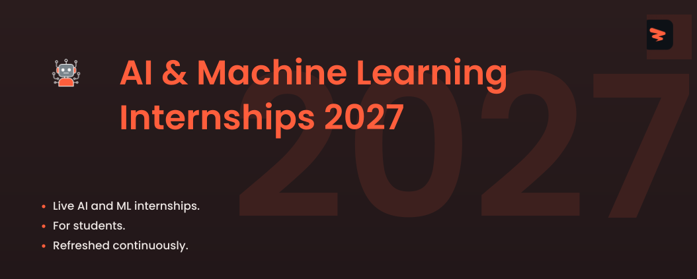

<!-- Cover -->

# AI & Machine Learning Internships 2027

🚀 Live AI, machine learning, and data science internships for students, refreshed through the Zapply job pipeline.

  
  
  
  

---

## **Website & Autofill Extension**

Explore Zapply's website and check out:

- Our Chrome extension, which autofills job applications in seconds.
- A dedicated job board featuring the latest openings across various roles.
- User accounts with multiple profiles for different resume types and roles.
- Job application tracking with streaks and commitment awards.

Experience an advanced career journey with us! 🚀

  

## Explore Around

Connect and seek advice from a growing network of fellow students and new grads.

  
  &nbsp;&nbsp;
  

---

 

<h3>🤖 <strong>Machine Learning & AI Engineering</strong></h3>

| Company | Role | Location | Posted | Visa | **Apply** |
|---------|------|----------|--------|------|----------|
| **Symbotic** | Intern- PhD Applied Scientist, Robotics Planning | USA Wilmington,  MA - | 45m | ✅ Sponsor |  |
| **ServiceNow** | Assoc AI Engineering (Cloud Security Automation) Intern | Santa Clara, CALIFORNIA | 20h | ✅ Sponsor |  |
| **Samsung Semiconductor** | Intern, AI System Architecture Research Scientist | San Jose, California, United States | 23h | ✅ Sponsor |  |
| **ICF** | 2027 Summer Intern, AI Engineer (Master's Degree, Reston, VA) | Reston, VA | 1d |  |  |
| **Bose** | Agentic AI Engineering Co-op – Active Noise Cancellation   Fall 2027 | US, MA - Framingham | 1d | ✅ Sponsor |  |
| **Toyota Research Institute** | Automated Driving Advanced Development Intern, Machine Learning Research | Los Altos, CA | 1d | ✅ Sponsor |  |
| **Riot Games** | Machine Learning Engineering Intern (Masters/PhD) - Summer 2027 | Los Angeles, USA | 1d | ✅ Sponsor |  |
| **General Motors** | 2027 Summer Intern – Machine Learning Engineer, AV/AI Platform | Sunnyvale, California, United... | 2d | ✅ Sponsor |  |
| **General Motors** | 2027 Summer Intern - Machine Learning Engineer, Embodied AI | Sunnyvale, California, United... | 2d | ✅ Sponsor |  |
| **Toyota Research Institute** | Automated Driving Advanced Development Intern, Machine Learning Research | Los Altos, CA | 2d | ✅ Sponsor |  |
| **ASML** | Internship- Co-Op: AI Engineer | San Diego, CA, USA | 3d | ✅ Sponsor |  |
| **ASML** | Internship- Co-Op: AI Engineer | San Diego, CA, USA | 3d | ✅ Sponsor |  |
| **ASML** | Internship-Co-Op: AI Engineer | San Diego, CA, USA | 3d | ✅ Sponsor |  |
| **Analog Devices** | Machine Learning for Computational Sensing Research Intern | US, MA, Boston | 3d | ✅ Sponsor |  |
| **NBCUniversal** | Media Tech: Data, AI & Machine Learning Internships – Summer 2027 | Universal City, CA | 3d | ✅ Sponsor |  |
| **NBCUniversal** | Media Tech: Data, AI & Machine Learning Internships – Summer 2027 | New York, NY | 3d | ✅ Sponsor |  |
| **T-Mobile** | Summer 2027 AI Engineering Internship | Bellevue, Washington | 5d | ✅ Sponsor |  |
| **T-Mobile** | Summer 2027 AI Engineering Internship | Bellevue, Washington | 5d | ✅ Sponsor |  |
| **T-Mobile** | Summer 2027 AI Engineering Internship | Bellevue, Washington | 5d | ✅ Sponsor |  |
| **Parspec** | Applied AI Engineer Intern | Hybrid - San Mateo, California | 5d |  |  |
| **Zillow** | Applied Scientist (Economics) Intern | Seattle-WA | 6d | ✅ Sponsor |  |
| **Waymo** | 2027 Summer Intern, PhD, Machine Learning - Generative World Models & Controllable Simulation | Mountain View, California,... | 6d | ✅ Sponsor |  |
| **Waymo** | 2027 Summer Intern, Machine Learning, MS/PhD, Simulation Realism (World Model) | Mountain View, California,... | 6d | ✅ Sponsor |  |
| **CACI** | AI/ML Engineering Co-op - Spring 2027 | King of Prussia, PA, US | 6d | ✅ Sponsor |  |
| **Match Group** | Machine Learning Engineer Intern | Palo Alto, California | 6d |  |  |
| **ICD** | Summer 2027 AI/ML Engineering Internship | Jersey City, NJ, United States | 6d |  |  |
| **Tradeweb** | Summer 2027 AI/ML Engineering Internship | Jersey City, NJ, United States | 6d |  |  |
| **PayPal** | Machine Learning Engineer Intern - Summer 2027 | San Jose, California, United... | 1w | ✅ Sponsor |  |
| **PayPal** | Machine Learning Engineer PhD Intern - Summer 2027 | San Jose, California, United... | 1w | ✅ Sponsor |  |
| **Thomson Reuters** | Research Scientist Intern | MN | 1w | ✅ Sponsor |  |
| **TEL** | Research Scientist - ATG Optical Sensor Development Intern (Summer 2027) | Austin RiverSouth | 1w |  |  |
| **NVIDIA** | Deep Learning Scientist Intern, LLM, Multimodal and Agentic AI - Summer 2027 | US, CA, Santa Clara | 1w | ✅ Sponsor |  |
| **Toyota Research Institute** | Automated Driving Advanced Development Intern, Machine Learning Research | Los Altos, CA | 1w | ✅ Sponsor |  |
| **ABB** | AI Engineering, ERP Intern- Summer 2027 | USA, NC, Cary | 1w | ✅ Sponsor |  |
| **ABB** | AI Engineering, Business Systems Intern- Summer 2027 | USA, NC, Cary | 1w | ✅ Sponsor |  |
| **Parsons** | AI/ML Engineering Intern Summer 2027 | VA, Centreville, R188194 | Date unknown |  |  |
| **ByteDance** | Research Scientist - Intern (Video and Edge, Multimedia Lab) - 2027 Start | San Diego, California | Date unknown | ✅ Sponsor |  |
| **The Mosaic Company** | Artificial Intelligence Co-Op/Intern - Summer 2027 | Tampa, FL | 1w | ✅ Sponsor |  |
| **KLA** | Machine Learning Engineer Intern | Milpitas, CA | 1w | ✅ Sponsor |  |
| **Intuitive** | AI/ML Engineer Intern | Sunnyvale, CA | 1w | ✅ Sponsor |  |
| **Roku** | Software Engineer Intern, AI Engineering | San Jose, California | 1w | ✅ Sponsor |  |
| **NVIDIA** | NVIDIA 2027 Internships: Deep Learning | US, CA, Santa Clara | 1w | ✅ Sponsor |  |
| **NVIDIA** | NVIDIA 2027 Internships: Deep Learning Computer Architecture | US, CA, Santa Clara | 1w | ✅ Sponsor |  |
| **Applied Materials** | New College Grad - Computational Physics & Agentic AI Engineer, Doctorate Degree (Spring 2027) | Santa Clara,CA | 1w | ✅ Sponsor |  |
| **General Motors** | 2027 Summer Intern – Research and Development – Vehicle Aerodynamics and Machine Learning | Warren, Michigan, United States... | 1w | ✅ Sponsor |  |
| **Waymo** | 2027 Summer Intern, PhD, Research Scientist Intern | Mountain View, CA, USA | 1w | ✅ Sponsor |  |
| **ByteDance** | Research Scientist - Intern (Video and Edge, Multimedia Lab) - 2027 Start (PhD) | San Jose, California | Date unknown | ✅ Sponsor |  |
| **Stripe** | PhD Machine Learning Engineer, Intern | San Francisco, New York City,... | 1w | ✅ Sponsor |  |
| **Stripe** | Master's Machine Learning Engineer, Intern | San Francisco, New York City,... | 1w | ✅ Sponsor |  |
| **Amazon.com Services LLC** | Software Development Engineer Intern, Machine Learning/Automated Reasoning- Summer 2027 | Seattle, WA | 1w | ✅ Sponsor |  |
| **Microsoft** | Applied Scientist: Internship Opportunities, Turing | Redmond, Washington, United States | 2w | ✅ Sponsor |  |
| **Q2** | 2027 Summer Internship - Machine Learning Engineer | Cary, North Carolina | 2w |  |  |
| **Q2** | 2027 Summer Internship - Machine Learning Engineer | Austin, Texas | 2w |  |  |
| **Microsoft** | Research Intern - Machine Learning and Optimization - Redmond | Redmond, Washington, United States | 2w | ✅ Sponsor |  |
| **Amazon.com Services LLC** | 2027 Applied Science Internship - Robotics - United States | North Reading, MA | 2w | ✅ Sponsor |  |
| **Entegris** | Lab Automation & AI Engineering Co-Op | Billerica, MA | 2w | ✅ Sponsor |  |
| **Micron Technology** | Intern -  AI Engineer Platform | Boise, ID - Main Site | 2w | ✅ Sponsor |  |
| **Saviynt** | Research Scientist Intern - PhD | Milpitas, California | 2w | ✅ Sponsor |  |
| **Salesforce** | Summer 2027 Intern - Applied Scientist, Optimization | California San Francisco | 2w | ✅ Sponsor |  |
| **Skydio** | PhD Autonomy Engineer Intern - Deep Learning / Computer Vision, 2027 | San Mateo, California, United... | 2w | ✅ Sponsor |  |
| **ByteDance** | Research Scientist Intern (Distributed NoSQL Database Systems) - 2027 Start (PhD) | Seattle, Washington | Date unknown | ✅ Sponsor |  |
| **Amperesand** | AI/ML Engineering Intern | Sunnyvale, California, United... | 2w | ✅ Sponsor |  |
| **Flagship Pioneering** | ProFound Therapeutics: AI/ML Engineering - SAGE Platform Co-Op | Cambridge, MA USA | 2w |  |  |
| **Symbotic** | Co-op- Machine Learning Ops | USA Wilmington,  MA - | 3w | ✅ Sponsor |  |
| **Cisco** | Machine Learning Engineer I (Intern) – United States | San Jose California US | 3w | ✅ Sponsor |  |
| **Cisco** | Machine Learning Engineer II (Intern) – United States | San Jose California US | 3w | ✅ Sponsor |  |
| **MITRE** | AI Engineering Intern | Bedford, Massachusetts | 3w |  |  |
| **Micron Technology** | Intern - Machine Learning Engineering | Richardson, TX | 3w | ✅ Sponsor |  |
| **Micron Technology** | Intern - SMAI Probe AI Engineer | Boise, ID - Main Site | 3w | ✅ Sponsor |  |
| **AeroVironment** | Machine Learning Engineering Intern | Centreville, VA | 3w |  |  |
| **Adobe** | 2027 Intern - Applied and Research Scientist/Engineer | San Jose | 3w | ✅ Sponsor |  |
| **KLA** | Computer Vision/Machine Learning Intern | Milpitas, CA | 3w | ✅ Sponsor |  |
| **Micron** | Intern - SMAI Probe AI Engineer | Boise, Idaho, United States of... | 3w |  |  |
| **Micron** | Intern - Machine Learning Engineering | Richardson, Texas, United... | 3w |  |  |
| **Scale AI** | Machine Learning Research Intern (Summer 2027) | New York, NY | 3w | ✅ Sponsor |  |
| **Microsoft** | Research Intern - Machine Learning at MSR NYC | New York, New York, United States | 3w | ✅ Sponsor |  |
| **KLA** | Research Scientist Intern - Plasma Light Source Characterization | Ann Arbor, MI | 4w | ✅ Sponsor |  |
| **Nissan** | Machine Learning Research Prediction and Planning Intern - Spring 2027 - Santa Clara, CA | Santa Clara, California -... | 4w |  |  |
| **Nissan** | Machine Learning Research Intern - Spring 2027 - Santa Clara, CA | Santa Clara, California -... | 4w |  |  |
| **Nissan** | Machine Learning Research Perception Intern - Spring 2027 - Santa Clara, CA | Santa Clara, California -... | 4w |  |  |
| **Field AI** | Robotics Research, Embodied AI Intern (Spring & Summer 2027) | Irvine, CA | 4w | ✅ Sponsor |  |
| **The Mosaic Company** | Artificial Intelligence Co-Op/Intern - Spring 2027 | Tampa, FL | 1mo | ✅ Sponsor |  |
| **Capital One** | Current PhD, AI Engineering Internship Program - Summer 2027 | New York, NY | 1mo | ✅ Sponsor |  |
| **Capital One** | Current Master's, AI Engineering Internship Program - Summer 2027 | New York, NY | 1mo | ✅ Sponsor |  |
| **TD Synnex** | Summer 2027 Internship Program   Technical, Applied Innovation Track: • Information Technology •... | Greenville, SC | 1mo | ✅ Sponsor |  |
| **AeroVironment** | Summer 2027 Machine Learning Intern | Minneapolis, MN | 1mo |  |  |
| **Campbell Soup Company** | Agentic AI Engineer Co-Op | USA - Remote | 1mo |  |  |
| **Campbell Soup Company** | Agentic AI Engineer Co-Op | USA - Remote | 1mo |  |  |
| **Bose** | Audio Machine Learning Co-op | US, MA - Framingham | 1mo | ✅ Sponsor |  |
| **Bose** | Embedded Audio ML Engineer Co-op | US, MA - Framingham | 1mo | ✅ Sponsor |  |
| **Symbotic** | Intern- Machine Learning Ops | USA Wilmington,  MA - | 1mo | ✅ Sponsor |  |
| **NREL** | Graduate Intern - LLM Reliability and Uncertainty for AI Science Assistants | Golden, CO | 1mo | ✅ Sponsor |  |
| **Visa** | Staff Research Scientist, Intern - PhD Quantum | Foster City, CA | 1mo | ✅ Sponsor |  |
| **Thomson Reuters** | Applied Scientist Intern | Ann Arbor, California | 1mo | ✅ Sponsor |  |
| **Crowe** | Machine Learning Intern | Chicago, IL | 1mo |  |  |
| **Nike** | NIKE, Inc. AI & Machine Learning, Innovation Graduate Internship | Beaverton, Oregon | 1mo | ✅ Sponsor |  |
| **Adobe** | 2027 Intern - Machine Learning Engineer | San Jose | 1mo | ✅ Sponsor |  |
| **Expedia Group** | Machine Learning Science Intern - PhD - 2026 - Austin, San Jose | Austin Domain 11 HomeAway | 1mo | ✅ Sponsor |  |
| **Expedia Group** | 2023 PhD Intern - Machine Learning Science | Austin Domain 11 HomeAway | 1mo | ✅ Sponsor |  |
| **ServiceNow** | AI Engineering - Assoc Software Engineer Internships - Summer 2027 (Bachelors) | Santa Clara, CALIFORNIA | 1mo | ✅ Sponsor |  |

Apply for more jobs at

<h3>📊 <strong>Data Science & Analytics</strong></h3>

| Company | Role | Location | Posted | Visa | **Apply** |
|---------|------|----------|--------|------|----------|
| **NREL** | Graduate (Year-Round) Intern: Geospatial Data Science Modeling and Analysis | Golden, CO | 45m | ✅ Sponsor |  |
| **Arch Capital Group** | Data Analytics Intern | Greensboro, NC United States of... | 2h |  |  |
| **Fresenius Medical Care** | Agentic AI Analytics Co-op | Lawrence, MA, USA | 2h | ✅ Sponsor |  |
| **SharkNinja** | Summer 2027: Data Science Intern (May to August) | Needham, MA, United States | 8h | ✅ Sponsor |  |
| **ICF** | 2027 Summer Intern, Data Analytics (Reston, VA or Remote) | Reston, VA | 1d |  |  |
| **Airbnb** | Advanced Analytics Intern | United States | 1d | ✅ Sponsor |  |
| **Bloom Energy** | RMCC Data Science Intern | San Jose, California | 1d | ✅ Sponsor |  |
| **Bloom Energy** | Data Science Intern | San Jose, California | 1d | ✅ Sponsor |  |
| **Genentech** | 2027 Summer Intern - Product Development Data Sciences | Boston | 1d | ✅ Sponsor |  |
| **Genentech** | 2027 Summer Intern - Biostatistics and Analytical Data Sciences | South San Francisco | 1d | ✅ Sponsor |  |
| **The Hartford** | Data Science Intern - Summer 2027 | Hartford, CT | 2d | ✅ Sponsor |  |
| **onsemi** | Spring 2027 - AI & Data Analytics Intern | Scottsdale, AZ, United States | 2d |  |  |
| **AstraZeneca** | Network Planning & Data Analytics Intern | – Tarzana – CA | 3d | ✅ Sponsor |  |
| **Federal Reserve System** | Summer 2027 Graduate Internship – Data Science | Minneapolis, MN | 3d |  |  |
| **Itron** | Intern - Data Analytics and Automation, Finance | WA | 3d | ✅ Sponsor |  |
| **NBCUniversal** | Advertising & Partnerships: Data Science Internship – Summer 2027 | New York, NY | 3d | ✅ Sponsor |  |
| **NBCUniversal** | Studio Operations, Data Analytics Internships – Summer 2027 | Universal City, CA | 3d | ✅ Sponsor |  |
| **MITRE** | Data Science Intern | McLean, Virginia | 4d |  |  |
| **Zoox** | Data Science Intern \[Summer 2027\] | Foster City, CA | 5d | ✅ Sponsor |  |
| **Zillow** | Data Science Intern | Seattle-WA | 6d | ✅ Sponsor |  |
| **Invesco** | Early Career Intern - Real Estate (Data Science) | Dallas, Texas | 6d |  |  |
| **SharkNinja** | Spring 2027: AI/Sharks Applied AI & Analytics Co-op (January to June) | Needham, MA, United States | 6d | ✅ Sponsor |  |
| **Bosch Group** | Motorsport Software and Data Analytics Graduate Intern | Farmington Hills, MI | 6d | ✅ Sponsor |  |
| **Match Group** | Data Scientist Intern | San Francisco, California | 6d |  |  |
| **CrowdStrike** | Sales Data Analytics Intern | Sunnyvale, CA | 1w | ✅ Sponsor |  |
| **PayPal** | Data Scientist Intern - Summer 2027 | San Jose, California, United... | 1w | ✅ Sponsor |  |
| **onsemi** | Summer 2027 - IE / Data Analytics Intern | Hopewell Junction, NY, United... | 1w |  |  |
| **Amgen** | Grad Intern – R&D TSRS Data Sciences Operations & Analytic (Summer 2027) | United States - Remote | 1w | ✅ Sponsor |  |
| **Microsoft** | Data Science: PhD Internship Opportunities - Redmond | Redmond, Washington, United States | 1w | ✅ Sponsor |  |
| **Trane Technologies** | 2027 AI & Analytics Intern | Davidson North Carolina | 1w |  |  |
| **Dow Jones** | Summer 2027 Internship Program - Marketing Data Science Intern | NYC | 1w | ✅ Sponsor |  |
| **Sierra Nevada Corporation** | Data Science Intern (Summer 2027) | Sparks, NV | 1w |  |  |
| **Booz Allen Hamilton** | University - 2027 Summer Games Data Scientist Intern - Royal Oak, MI | Detroit, MI | 1w | ✅ Sponsor |  |
| **Intuitive** | Data Science Intern | Sunnyvale, CA | 1w | ✅ Sponsor |  |
| **Leidos** | Data Science Intern | Arlington, VA | 1w | ✅ Sponsor |  |
| **Northrop Grumman** | 2027 Intern Product Support – Data Scientist | United States-California-San Diego | 1w |  |  |
| **Cigna** | The Cigna Group's Technology Development Program - Data & Analytics Engineering Track Summer... | Bloomfield, CT | 1w | ✅ Sponsor |  |
| **UPS** | MHR Summer 2027 Intern - Data Analytics (HR Systems) | ATLANTA, Georgia | 1w |  |  |
| **University of Miami** | Data Science & AI Intern | Miami, Florida | 1w |  |  |
| **MITRE** | Data Science and Engineering Intern | McLean, Virginia | 1w |  |  |
| **Booz Allen Hamilton** | University - 2027 Summer Games Data Scientist Intern - Annapolis Junction, MD | Annapolis Junction, MD | 2w | ✅ Sponsor |  |
| **Booz Allen Hamilton** | University - 2027 Summer Games Data Scientist Intern - Ft. Walton Beach, FL | Fort Walton Beach, FL | 2w | ✅ Sponsor |  |
| **Q2** | 2027 Summer Internship - Data Science | Cary, North Carolina | 2w |  |  |
| **Q2** | 2027 Summer Internship - Data Science | Austin, Texas | 2w |  |  |
| **Micron Technology** | Intern - Data Science | San Jose, CA | 2w | ✅ Sponsor |  |
| **Applied Materials** | Summer 2027 Data Science Intern- Bachelor's/Master's (Santa Clara, CA) | Santa Clara,CA | 2w | ✅ Sponsor |  |
| **Applied Materials** | Summer 2027 Data Scientist Intern - Master's (Santa Clara, CA) | Santa Clara,CA | 2w | ✅ Sponsor |  |
| **Applied Materials** | Summer 2027 Data Scientist Intern -Bachelor's (Austin, TX) | Austin,TX | 2w | ✅ Sponsor |  |
| **Visa** | Data Science Intern, Data and AI Team – Summer 2027 | Foster City, CA | 2w | ✅ Sponsor |  |
| **Micron** | Intern - Data Science | San Jose, California, United... | 2w |  |  |
| **NXP** | Data Science / Structured Problem Solving Intern - Summer 2027 | Austin | 2w | ✅ Sponsor |  |
| **Micron Technology** | Intern - HBM Data Scientist | Richardson, TX | 2w | ✅ Sponsor |  |
| **Thermo Fisher Scientific** | Sr. Operations Data Analytics Intern | Logan, Utah, USA | 2w | ✅ Sponsor |  |
| **Micron** | Intern - HBM Data Scientist | Richardson, Texas, United... | 2w |  |  |
| **onsemi** | Summer 2027 - AI & Data Science Intern | San Jose, CA, United States | 2w |  |  |
| **Stevens Capital Management** | Quantitative Research Analyst Internship | Radnor, PA | Date unknown |  |  |
| **Google** | Data Scientist, Research Intern, PhD, Summer 2027 | United States | Date unknown | ✅ Sponsor |  |
| **Google** | Business Data Scientist Intern, PhD, Summer 2027 | United States | Date unknown | ✅ Sponsor |  |
| **Google** | People Analytics Intern, PhD, Summer 2027 | United States | Date unknown | ✅ Sponsor |  |
| **ByteDance** | Data Lake Infrastructure & Data Analytics Research Engineer Intern (AML-Ark-US) - 2027 Summer | Seattle, Washington | Date unknown | ✅ Sponsor |  |
| **ByteDance** | Data Lake Infrastructure & Data Analytics Research Engineer Intern (AML-Ark-US) - 2027 Summer | San Jose, California | Date unknown | ✅ Sponsor |  |
| **Dell Technologies** | Services Data Science Graduate Intern | TX, United States | 2w |  |  |
| **CVS Health** | Innovation & Technology Internship - Data Science - Summer 2027 (Undergraduate) | NY - New York | 2w | ✅ Sponsor |  |
| **Rivian and Volkswagen Group Technologies** | Data Engineering Intern - AI & Analytics (Summer 2027) | Palo Alto, California | 2w | ✅ Sponsor |  |
| **CVS Health** | Medicaid Data Analytics Corporate Internship - Summer 2027 (Undergraduate) | CT - Hartford | 3w | ✅ Sponsor |  |
| **CVS Health** | Innovation & Technology Internship - Data Science - Summer 2027 (Graduate) | NY - New York | 3w | ✅ Sponsor |  |
| **ABB** | Sales Excellence Data Analytics Intern - Summer 2027 | USA, NC, Cary | 3w | ✅ Sponsor |  |
| **Ardian** | Data Scientist Intern - February 2027   NYC | New York | 3w |  |  |
| **RTX** | Data Science Engineering Co-Op (January 2027) (Hybrid) | PR-AGUADILLA | 3w | ✅ Sponsor |  |
| **Intel** | AI Data Science / Software Engineering PhD Intern New 2027 | US, California, Santa Clara | 3w | ✅ Sponsor |  |
| **Intel** | AI Data Science / Software Engineering PhD Intern New 2027 | US, Oregon, Hillsboro | 3w | ✅ Sponsor |  |
| **Intel** | AI Data Science / Software Engineering PhD Intern New 2027 | US, Oregon, Hillsboro | 3w | ✅ Sponsor |  |
| **Johnson & Johnson** | Quality Data Science Co-Op , Summer 2027 | Cincinnati, Ohio, United States... | 3w | ✅ Sponsor |  |
| **KLA** | Tax & Data Analytics Intern | Ann Arbor, MI | 3w | ✅ Sponsor |  |
| **Carrier Global** | Data Analytics Intern - Summer | CAI23: Carrier-Indianapolis,... | 3w |  |  |
| **Zoetis** | Chemistry Data Science Intern - Digital CMC Workflows | Kalamazoo - Downtown Portage Street | 3w | ✅ Sponsor |  |
| **Duolingo** | Data Scientist, Intern (PhD) | New York, NY | 4w | ✅ Sponsor |  |
| **Nissan** | People Analytics Intern - Summer 2027 - Franklin, TN | Franklin, Tennessee - United... | 4w |  |  |
| **National Interstate Insurance** | Third-Party Risk & Analytics Intern (Year-Round) | Cincinnati, OH | 4w |  |  |
| **ABB** | Data Analytics Intern | New Berlin, Wisconsin, United... | 4w | ✅ Sponsor |  |
| **Point72** | 2027 Summer Internship - MS/PhD Data Scientist, Proprietary Research | New York, NY | 4w | ✅ Sponsor |  |
| **Stryker** | Summer 2027 Internship - Data Analytics - Michigan | Portage, Michigan | 1mo | ✅ Sponsor |  |
| **Stryker** | Summer 2027 Internship - Data Analytics - Customer One - Illinois | Cary, Illinois | 1mo | ✅ Sponsor |  |
| **AspenTech** | Data Science Intern - Summer 2027 - Bedford, MA | Bedford, Massachusetts | 1mo | ✅ Sponsor |  |
| **Zoetis** | Non-Clinical and Diagnostics Statistician Intern | Kalamazoo - Downtown Portage Street | 1mo | ✅ Sponsor |  |
| **Zoetis** | Summer Intern – Pharmacogenomics Data Science & Genomic Prediction (VMRD) | Kalamazoo - Downtown Portage Street | 1mo | ✅ Sponsor |  |
| **Cboe** | Quant & Data Analytics Intern | Chicago, IL | 1mo | ✅ Sponsor |  |
| **Arrowstreet Capital** | Quantitative Researcher Intern, Summer 2027 | Boston | 1mo |  |  |
| **Vanguard** | College to Corporate IT Internship - Data Science (PA) | Malvern, PA | 1mo | ✅ Sponsor |  |
| **Vanguard** | College to Corporate IT Internship - Data Science (NC) | Charlotte, NC | 1mo | ✅ Sponsor |  |
| **TD Synnex** | Summer 2027 Internship Program   Commercial, High Growth Track: • Sales • Marketing • Vendor... | Greenville, SC | 1mo | ✅ Sponsor |  |
| **Plexus** | Intern - IT Data Science (Summer 2027) | Neenah, WI | 1mo |  |  |
| **Brunswick** | Mercury Marine: Data Analytics Internship | Fond du Lac, WI | 1mo | ✅ Sponsor |  |
| **Campbell Soup Company** | Data Science Intern | USA - NJ - Camden | 1mo |  |  |
| **Campbell Soup Company** | Data Science Intern | USA - NJ - Camden | 1mo |  |  |
| **GE Aerospace** | SaaS - Flight Analytics Platform - Data Science Co-op - Spring 2027 | Austin | 1mo | ✅ Sponsor |  |
| **Bose** | Data Analytics Engineer Co-op | MA Framingham | 1mo | ✅ Sponsor |  |
| **Momentive** | Summer 2027 Intern - Enterprise Reporting & Analytics - Data Science | NY Niskayuna | 1mo |  |  |
| **Nissan** | Data Science Intern - Summer 2027 - Smyrna, TN | Smyrna, Tennessee - United... | 1mo |  |  |
| **Nissan** | Data Science Intern - Summer 2027 - Franklin, TN | Franklin, Tennessee - United... | 1mo |  |  |

Apply for more jobs at

<h3>🔬 <strong>AI Product & Research</strong></h3>

| Company | Role | Location | Posted | Visa | **Apply** |
|---------|------|----------|--------|------|----------|
| **Bosch Group** | AI Research Intern – Time Series Foundation Models | Sunnyvale, California | 6h | ✅ Sponsor |  |
| **Rhoda AI** | Research Intern | Mountain View | 21h | ✅ Sponsor |  |
| **Toyota Research Institute** | Future Product Innovation Research Intern, Human-AI Computational Design | Los Altos, CA | 22h | ✅ Sponsor |  |
| **Salesforce** | Summer 2027 Intern - Applied AI Strategy & Research | California - San Francisco | 2d | ✅ Sponsor |  |
| **Booz Allen Hamilton** | University - Summer 2027 Quantum Computing Research Intern | Washington, DC | 2d | ✅ Sponsor |  |
| **Microsoft** | Research Intern - Next-Generation AI Agents | Redmond, Washington, United States | 3d | ✅ Sponsor |  |
| **Microsoft** | Research Intern - Research in Software Engineering, ML Systems, Agents | Redmond, Washington, United States | 1w | ✅ Sponsor |  |
| **NVIDIA** | Applied Research Intern, Integrated Sensing and Communications (ISAC)-NVIDIA Aerial - Summer 2027 | US, CA, Santa Clara | 1w | ✅ Sponsor |  |
| **NVIDIA** | PhD Research Intern, Embodied and Agentic AI - 2027 | CA Santa Clara | 1w | ✅ Sponsor |  |
| **NVIDIA** | PhD Research Intern, Fundamental Generative AI - 2027 | US, CA, Santa Clara | 1w | ✅ Sponsor |  |
| **Toyota Research Institute** | Human Interactive Driving Research Intern, World Models | Los Altos, CA | 2w | ✅ Sponsor |  |
| **Toyota Research Institute** | Human Interactive Driving Research Intern, Decision-Making for Driving at the Limits | Los Altos, CA | 2w | ✅ Sponsor |  |
| **ByteDance** | Research Intern (Frontier AI Systems) - 2027 Start (PhD) | San Jose, California | Date unknown | ✅ Sponsor |  |
| **ByteDance** | Applied Research Intern - AI Safety Security - Global Frontier Tech Recruitment Program - 2027... | San Jose, California | Date unknown | ✅ Sponsor |  |
| **OpenSesame** | AI Product Builder Intern | Austin | 3w |  |  |
| **Cisco** | AI Operations Engineer I (Intern) – United States | San Jose California US | 3w | ✅ Sponsor |  |
| **DoorDash** | Operations Research Intern (PhD), Summer 2027 | Sunnyvale, CA | 3w | ✅ Sponsor |  |
| **Bosch Group** | AI Research Intern: Wireless Foundation Models | Pittsburgh, PA | 3w | ✅ Sponsor |  |
| **Together AI** | Research Intern, Frontier Speculative Decoding (Summer 2027) | San Francisco | 3w | ✅ Sponsor |  |
| **Hitachi** | Research Intern, Knowledge Engineering & Generative AI | Santa Clara, California, United... | 4w | ✅ Sponsor |  |
| **Capital One** | Current PhD, Applied Research Internship Program - Summer 2027 | New York, NY | 1mo | ✅ Sponsor |  |
| **Mercor** | Research Intern | San Francisco | 1mo |  |  |
| **Together AI** | Research Intern, Model Shaping (Summer 2027) | San Francisco, Amsterdam | 1mo | ✅ Sponsor |  |
| **XPENG Motors** | AI Research Intern – Predictive World Model | Santa Clara, CA | 1mo |  |  |
| **The Nuclear Company** | Summer 2027 AI Applied Research Internship | Washington, DC | 2026-08-14 |  |  |
| **The Nuclear Company** | Spring 2027 AI Applied Research Internship | Washington, DC | 2026-08-14 |  |  |
| **Modal** | ML Research Intern | New York | 2026-07-28 |  |  |
| **Block** | Applied Research Intern, Proactive Intelligence & Customer World Models (PhD / Graduate Co-op) | Bay Area, CA, United States of... | 2026-06-09 | ✅ Sponsor |  |
| **Samaya AI** | ML Research Intern | Mountain View, California,... | 2025-02-20 | ✅ Sponsor |  |

Apply for more jobs at

<h3>✨ <strong>Other AI & ML Internships</strong></h3>

| Company | Role | Location | Posted | Visa | **Apply** |
|---------|------|----------|--------|------|----------|
| **ASML** | Internship/Co-Op: Data Engineer | San Diego, CA, USA | 16m | ✅ Sponsor |  |
| **Microsoft** | Applied Science: Internship Opportunities - Redmond | Redmond, Washington, United States | 3h | ✅ Sponsor |  |
| **Microsoft** | Applied Science: PhD Internship Opportunities - Multiple Locations | Redmond, Washington, United States | 1d | ✅ Sponsor |  |
| **Riot Games** | Data Engineering Intern - Summer 2027 | Los Angeles, USA | 1d | ✅ Sponsor |  |
| **Clarios** | IT Digital/AI Intern (Summer 2027) | WI | 2d | ✅ Sponsor |  |
| **National Interstate Insurance** | M&A Intern | Ohio | 2d |  |  |
| **National Interstate Insurance** | IT Summer Internship Program Event Coordinator Intern - Summer 2027 | Cincinnati, OH | 2d |  |  |
| **National Interstate Insurance** | Claims Technical Analyst Intern - Summer 2027 | Cincinnati, OH | 2d |  |  |
| **Highmark Health** | Summer 2027 Data Analyst enGen Undergraduate Intern | Pittsburgh PA, 15222, PAP, Penn... | 2d | ✅ Sponsor |  |
| **Parspec** | Product Management Intern, Agentic AI | Hybrid - San Mateo, California | 2d |  |  |
| **Jabil** | AI Agent Developer Intern (Supply Chain IT - AI & Enablement) | St. Petersburg/Tampa, FL | 2d | ✅ Sponsor |  |
| **The New York Times** | ML Scientist Intern | New York, NY | 2d | ✅ Sponsor |  |
| **The New York Times** | Data Analyst Intern | New York, NY | 2d | ✅ Sponsor |  |
| **Moderna** | 2027 Co-Op, Safety Epidemiology | Bethesda, Maryland, Clinical... | 3d |  |  |
| **Moderna** | Intern, Biobanking | Norwood, Massachusetts,... | 3d |  |  |
| **Warner Bros. Discovery** | WB Games Data Engineering Co-op: Needham, MA - January-May 2027 | MA Needham 117 Kendrick St | 3d | ✅ Sponsor |  |
| **Lila Sciences** | Co-op, Software, Applied AI Platform Engineer | San Francisco, CA USA | 3d | ✅ Sponsor |  |
| **T-Mobile** | Summer 2027 Data Engineering Internship | Frisco Texas | 5d | ✅ Sponsor |  |
| **T-Mobile** | Summer 2027 Data Engineering Internship | Frisco Texas | 5d | ✅ Sponsor |  |
| **Oshkosh Corporation** | Customer Support AI Intern | McConnellsburg, Pennsylvania,... | 6d |  |  |
| **Lila Sciences** | Co-op, AI for Protein Design | San Francisco, CA USA | 6d | ✅ Sponsor |  |
| **KLA** | Algorithm Engineering Intern | Ann Arbor, MI | 6d | ✅ Sponsor |  |
| **ASM** | Intern, Product Intelligence Engineering (AI/ML) | > Arizona > Phoenix | 6d |  |  |
| **Vertex Pharmaceuticals** | Spring 2027 Co-Op, Structural Biology & Biophysics | Boston, MA | Date unknown |  |  |
| **AstraZeneca** | Manufacturing Digital and AI Intern | Gaithersburg - MD | 1w | ✅ Sponsor |  |
| **JM Family Enterprises** | Data Engineering Intern | Florida - Deerfield Beach | 1w |  |  |
| **Moderna** | 2027 Intern, Data Management | Cambridge, Massachusetts,... | 1w |  |  |
| **Leidos** | Software Engineering & AI Intern | 6314 RemoteTeleworker US | 1w | ✅ Sponsor |  |
| **Tenet Healthcare** | Data Engineer Intern  – Summer 2027 – Onsite in Dallas, TX | Dallas, TX, United States | 1w |  |  |
| **Microchip Technology** | Intern (Data Analyst) | OR - Gresham | 1w | ✅ Sponsor |  |
| **Bose** | DSP/ML Research Engineer Intern   Summer 2027 | US, MA - Framingham | 1w | ✅ Sponsor |  |
| **Bose** | DSP/ML Research Engineer Co-op   Spring 2027 | US, MA - Framingham | 1w | ✅ Sponsor |  |
| **IMC Trading** | Research Analyst Intern - Summer 2027 | Chicago, United States | 1w | ✅ Sponsor |  |
| **T-Mobile** | Summer 2027 Business Development, Physical & Edge AI Internship | Bellevue, Washington | 1w | ✅ Sponsor |  |
| **Samsung Research America Internship** | 2027 Summer Intern, Generative AI based Imaging and Video R&D | 6105 Tennyson Pkwy, Suite 300,... | 1w |  |  |
| **JM Family Enterprises** | AI & Decision Science Intern | Florida - Deerfield Beach | 1w |  |  |
| **Trimble** | AI Developer Intern | OH Dayton | 1w | ✅ Sponsor |  |
| **Trimble** | AI Developer Intern | CO Westminster | 1w | ✅ Sponsor |  |
| **The New York Times** | Advertising Business Data Analyst Intern | New York, NY | 1w | ✅ Sponsor |  |
| **Sherwin-Williams** | 2027 R&D Data Visualization Intern- Cleveland | Brecksville, OH, United States | 1w | ✅ Sponsor |  |
| **Dell Technologies** | Global Marketing Graduate AI & Data Intern | Round Rock, TX, United States | 1w |  |  |
| **Dow Jones** | Summer 2027 Internship Program – Data Analyst Intern | NYC | 1w | ✅ Sponsor |  |
| **Dow Jones** | Summer 2027 Internship Program – Data Analyst Intern | NYC | 1w | ✅ Sponsor |  |
| **Dow Jones** | Summer 2027 Internship Program – Research Analyst Intern | Houston, TX - OPIS | 1w | ✅ Sponsor |  |
| **Entrust** | AI Developer Intern | MN | 1w | ✅ Sponsor |  |
| **LabCorp** | Co-op - Agentic AI Developer | Durham NC | 1w | ✅ Sponsor |  |
| **NVIDIA** | Technical Product Marketing MBA Intern, AI Infrastructure - Summer 2027 | US, CA, Santa Clara | 1w | ✅ Sponsor |  |
| **NVIDIA** | Product Marketing MBA Intern, AI Infrastructure — Summer 2027 | US, CA, Santa Clara | 1w | ✅ Sponsor |  |
| **Microsoft** | Researcher Intern, CoreAI | Redmond, Washington, United States | 1w | ✅ Sponsor |  |
| **KLA** | Software Engineer (AI/ML) Intern | Austin, TX | 1w | ✅ Sponsor |  |
| **Vertex Pharmaceuticals** | Spring 2027 Co-op, Environmental, Social and Governance | Boston, MA | Date unknown |  |  |
| **Trace3** | Workplace AI Intern | Detroit, MI | 1w |  |  |
| **WSP** | Transportation Data Analyst Intern - Summer 2027 | Seattle, WA, United States | 1w | ✅ Sponsor |  |
| **Cisco** | Data Analyst I (Intern) - United States | San Jose California US | 1w | ✅ Sponsor |  |
| **Firework** | Data Engineer Intern | San Mateo, California | 1w | ✅ Sponsor |  |
| **Divergent Technologies** | Summer 2027 Business Intelligence Intern | Torrance, California, United States | 1w |  |  |
| **Salesforce** | AI Labs Summer Internship, Emerging Talent | California San Francisco | 1w | ✅ Sponsor |  |
| **NVIDIA** | VLSI CAD Timing Intern, Applied AI - Summer 2027 | US, CA, Santa Clara | 1w | ✅ Sponsor |  |
| **Illinois Tool Works** | Marketing Research Analyst Intern (Summer 2027) | Glenview, Illinois | 1w | ✅ Sponsor |  |
| **Cisco** | Data Analyst I (Intern) - United States | San Jose, California | 1w | ✅ Sponsor |  |
| **MITRE** | Trustworthy AI Intern | McLean, Virginia | 1w |  |  |
| **Philips** | Co-op – Data Engineer (Biocompatibility) – Murrysville, PA – January to June 2027 | Murrysville, Pennsylvania,... | 2w | ✅ Sponsor |  |
| **Axiom Space** | Enterprise Data Analyst Intern, Power BI & Data Quality (Summer 2027) | Houston | 2w |  |  |
| **Amazon.com Services LLC** | UX Researcher Intern – Summer 2027 | Seattle, WA | 2w | ✅ Sponsor |  |
| **GM Financial** | Intern - Data Engineer | Arlington, TX, United States | 2w |  |  |
| **MITRE** | Internships in Generative and Agentic AI | McLean, Virginia | 2w |  |  |
| **NREL** | Graduate Intern  – Agentic AI-Driven Computational Synthesis of PGM-free Fuel Cell Catalysts | Golden, CO | 2w | ✅ Sponsor |  |
| **Itron** | Intern - Data Engineering | WA | 2w | ✅ Sponsor |  |
| **Micron Technology** | Intern - Memory Performance and Power Modeling | San Jose, CA | 2w | ✅ Sponsor |  |
| **Leidos** | Data Engineer Intern | Fort Belvoir, VA | 2w | ✅ Sponsor |  |
| **Applied Materials** | Summer 2027 Business Intelligence Analyst Intern- Master's (Santa Clara, CA) | Santa Clara,CA | 2w | ✅ Sponsor |  |
| **Micron** | Intern - Memory Performance and Power Modeling | San Jose, California, United... | 2w |  |  |
| **Arrowstreet Capital** | Investment Processes Intern, Summer 2027 | Boston | 2w |  |  |
| **Federal Reserve System** | 2027 Summer Internship Program - REIN Data Intern | Atlanta, GA | 2w |  |  |
| **Wells Fargo** | 2027 Technology Summer Internship – Early Careers (Data Engineering) | CHARLOTTE, NC | 2w | ✅ Sponsor |  |
| **onsemi** | Spring 2027 - Customer Operations Data Analyst Intern | Scottsdale, AZ, United States | 2w |  |  |
| **Lila Sciences** | Co-Op, Reaction Prediction & Benchmarking | Cambridge, MA USA | 2w | ✅ Sponsor |  |
| **The Travelers Companies** | Decision Science - Marketing & Communications Intern | CT - Hartford | 2w |  |  |
| **CVS Health** | Innovation & Technology Internship – Data Engineering – Summer 2027 (Undergraduate) | TX - Irving | 2w | ✅ Sponsor |  |
| **HPE (University)** | AI/ML Developer Intern | San Jose, California | 2w | ✅ Sponsor |  |
| **Vertex Pharmaceuticals** | Spring Co-Op 2027, Biologics MSAT | Boston, MA | Date unknown |  |  |
| **Google** | Student Researcher, PhD, Fall 2026 | United States | Date unknown | ✅ Sponsor |  |
| **Google** | Student Researcher, BS/MS, Fall 2026 | United States | Date unknown | ✅ Sponsor |  |
| **Google** | Student Researcher, PhD, Winter-Summer 2027 | United States | Date unknown | ✅ Sponsor |  |
| **ByteDance** | Video/Image AI/ML Software Engineer Intern (Multimedia) - 2027 Start (PhD) - Intern (Video and... | San Diego, California | Date unknown | ✅ Sponsor |  |
| **ByteDance** | Intelligent Sensing Intern - Low-power Agent Sensing and Computing Systems - Global Frontier... | San Jose, California | Date unknown | ✅ Sponsor |  |
| **ByteDance** | AI Perception Intern (PICO) - 2027 Start (PhD) | San Jose, California | Date unknown | ✅ Sponsor |  |
| **Merck & Co.** | 2027 Future Talent Program - AI/ML Biomedical Imaging and Computational Pathology - Intern | USA - Massachusetts - Cambridge | 2w | ✅ Sponsor |  |
| **Merck & Co.** | 2027 Future Talent Program - Data, AI, and Genome Sciences, Foundation Models - Intern | USA - Massachusetts - Cambridge | 2w | ✅ Sponsor |  |
| **Waymo** | 2027 Summer Intern, MS/PhD, Software Engineer, ML Frameworks and Efficiency | Mountain View, CA, USA | 2w | ✅ Sponsor |  |
| **HNTB** | New Grad GIS Analyst I (For Current/Previous HNTB Interns ONLY) | Tallahassee, FL | 2w |  |  |
| **KLA** | Software Engineering Intern – AI/ML for Diagnostics & Calibration | Milpitas, CA | 2w | ✅ Sponsor |  |
| **Flagship Pioneering** | ProFound Therapeutics: Bioinformatics Data Engineering Co-Op | Cambridge, MA USA | 2w |  |  |
| **Bosch Group** | Agentic AI R&D Intern | Sunnyvale, CA | 2w | ✅ Sponsor |  |
| **LabCorp** | Intern - Bioinformatics | Baltimore MD | 2w | ✅ Sponsor |  |
| **Waymo** | 2027 Summer Intern, PhD, Research, RSI for Autonomous Driving | Mountain View, CA, USA | 3w | ✅ Sponsor |  |
| **Waymo** | 2027 Summer Intern, PhD, Research, Multimodal Foundation Models | Mountain View, CA, USA | 3w | ✅ Sponsor |  |
| **Leidos** | AI/ML Intern | Huntsville, AL | 3w | ✅ Sponsor |  |
| **CVS Health** | Innovation & Technology Internship – Data Engineering – Summer 2027 (Undergraduate) | NY - New York | 3w | ✅ Sponsor |  |
| **CVS Health** | Innovation & Technology Internship – Data Engineering – Summer 2027 (Graduate) | NY - New York | 3w | ✅ Sponsor |  |

Apply for more jobs at

---

### Live Job Boards

  
  &nbsp;&nbsp;
  
  &nbsp;&nbsp;
  

  
  &nbsp;&nbsp;
  
  &nbsp;&nbsp;
  

  
  &nbsp;&nbsp;
  
  &nbsp;&nbsp;
  

  
  &nbsp;&nbsp;
  

### Curated Internships

  
  &nbsp;&nbsp;
  
  &nbsp;&nbsp;
  

  

### Career Resources

  
  &nbsp;&nbsp;
  

---

Add new jobs to our listings keeping in mind the following:

- Located in the US.
- Create a new issue to submit different job positions.
- Update a job by submitting an issue with the job URL and required changes.

Our team reviews within 24-48 hours and approved jobs are added to the main list!

Questions? Create a miscellaneous issue, and we'll assist! 🙏

**🎯 722 current opportunities from 234 companies**

**Found this helpful? Give it a ⭐ to support Zapply!**

*Not affiliated with any companies listed. All applications redirect to official career pages.*

---

## Data & Reuse

Job listings are public information provided by employers, who remain responsible for their accuracy. The compilation and the added data fields (skills, degree and visa estimates, tags) are by Zapply.

You may use, share, and build on this data, including for commercial purposes, as long as you:

- Link back to this repository as the source (followed link, no nofollow).
- Credit Zapply as the data source.
- Do not resubmit the listings to third-party job aggregators or feeds.
- Do not present Zapply enrichment fields as official employer statements; they are automated estimates provided as-is, without warranty.

You may use the name Zapply to attribute the data. Please do not use the Zapply logo or imply endorsement without written permission.

Questions or a different use? Open an issue. We say yes more often than not.

---

**Last Updated**: November 12, 2026

