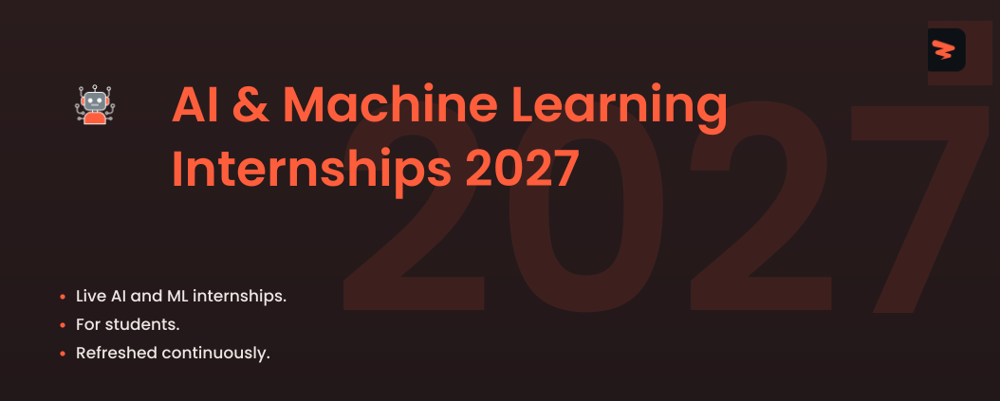

<!-- Cover -->

# AI & Machine Learning Internships 2027

🚀 Live AI, machine learning, and data science internships for students, refreshed through the Zapply job pipeline.

  
  
  
  

---

## **Website & Autofill Extension**

Explore Zapply's website and check out:

- Our Chrome extension, which autofills job applications in seconds.
- A dedicated job board featuring the latest openings across various roles.
- User accounts with multiple profiles for different resume types and roles.
- Job application tracking with streaks and commitment awards.

Experience an advanced career journey with us! 🚀

  

## Explore Around

Connect and seek advice from a growing network of fellow students and new grads.

  
  &nbsp;&nbsp;
  

---

 

<h3>🤖 <strong>Machine Learning & AI Engineering</strong></h3>

| Company | Role | Location | Posted | Visa | **Apply** |
|---------|------|----------|--------|------|----------|
| **ByteDance** | Research Scientist Intern (Distributed NoSQL Database Systems) - 2027 Start (PhD) | Seattle, Washington | Date unknown | ✅ Sponsor |  |
| **ByteDance** | Machine Learning Engineer Intern (E-Commerce Risk Control)- 2027 Start (PhD) | Seattle, Washington | Date unknown | ✅ Sponsor |  |
| **ByteDance** | Research Scientist Intern (Multi-modal Agentic Databases) - 2027 Start (PhD) | San Jose, California | Date unknown | ✅ Sponsor |  |
| **Waymo** | 2027 Summer Intern, MS/PhD, Machine Learning, Driver Refinement Foundations | San Francisco, CA, USA | 1d | ✅ Sponsor |  |
| **Amperesand** | AI/ML Engineering Intern | Sunnyvale, California, United... | 1d | ✅ Sponsor |  |
| **Flagship Pioneering** | ProFound Therapeutics: AI/ML Engineering - SAGE Platform Co-Op | Cambridge, MA USA | 2d |  |  |
| **Zillow** | Applied Scientist (Economics) Intern | Seattle-WA | 2d | ✅ Sponsor |  |
| **NVIDIA** | NVIDIA 2027 Internships: Deep Learning Computer Architecture | US, CA, Santa Clara | 3d | ✅ Sponsor |  |
| **Genentech** | 2027 Spring Intern - Data Science & Machine Learning | South San Francisco | 3d | ✅ Sponsor |  |
| **Symbotic** | Co-op- Machine Learning Ops | USA Wilmington,  MA - | 3d | ✅ Sponsor |  |
| **Cisco** | Machine Learning Engineer I (Intern) – United States | San Jose California US | 4d | ✅ Sponsor |  |
| **Cisco** | Machine Learning Engineer II (Intern) – United States | San Jose California US | 4d | ✅ Sponsor |  |
| **KLA** | Computer Vision/Machine Learning Intern | Milpitas, CA | 5d | ✅ Sponsor |  |
| **AeroVironment** | Machine Learning Engineering Intern | Centreville, VA | 5d |  |  |
| **Adobe** | 2027 Intern - Applied and Research Scientist/Engineer | San Jose | 5d | ✅ Sponsor |  |
| **Micron Technology** | Intern - Machine Learning Engineering | Richardson, TX | 5d | ✅ Sponsor |  |
| **Micron Technology** | Intern - SMAI Probe AI Engineer | Boise, ID - Main Site | 5d | ✅ Sponsor |  |
| **Waymo** | 2027 Summer Intern, PhD, Machine Learning - Simulation & Closed-Loop Training | Mountain View, California,... | 5d | ✅ Sponsor |  |
| **Scale AI** | Machine Learning Research Intern (Summer 2027) | New York, NY | 5d | ✅ Sponsor |  |
| **Waymo** | 2027 Summer Intern, PhD, Research Scientist, Visual Reasoning | Mountain View, CA, USA | 6d | ✅ Sponsor |  |
| **KLA** | Research Scientist Intern - Plasma Light Source Characterization | Ann Arbor, MI | 1w | ✅ Sponsor |  |
| **General Motors** | 2027 Summer Intern, AI/ML Engineer, Mapping (Masters) | Warren, Michigan, United States... | 1w | ✅ Sponsor |  |
| **NREL** | Graduate (3-12 month) Intern - Artificial Intelligence for Power System Operations | Golden, CO | 1w | ✅ Sponsor |  |
| **General Motors** | 2027 Intern - AI/ML Engineer - Capacity & Performance Engineering, Autonomous Vehicles | Sunnyvale, California, United... | 1w | ✅ Sponsor |  |
| **General Motors** | 2027 Intern - AI/ML Engineer, Autonomous Vehicle ML Infrastructure | Sunnyvale, California, United... | 1w | ✅ Sponsor |  |
| **ICF** | 2027 Summer Intern, AI Engineer (Reston, VA) | Reston, VA | 1w |  |  |
| **ICF** | 2027 Summer Intern, AI Engineer (Reston, VA) | Reston, VA | 1w |  |  |
| **Nissan** | Machine Learning Research Prediction and Planning Intern - Spring 2027 - Santa Clara, CA | Santa Clara, California -... | 1w |  |  |
| **Nissan** | Machine Learning Research Intern - Spring 2027 - Santa Clara, CA | Santa Clara, California -... | 1w |  |  |
| **Nissan** | Machine Learning Research Perception Intern - Spring 2027 - Santa Clara, CA | Santa Clara, California -... | 1w |  |  |
| **Field AI** | Robotics Research, Embodied AI Intern (Spring & Summer 2027) | Irvine, CA | 1w | ✅ Sponsor |  |
| **ServiceNow** | AI Engineering - Assoc Software Engineer Internships - Summer 2027 (Bachelors) | Santa Clara, CALIFORNIA | 1w | ✅ Sponsor |  |
| **ServiceNow** | AI Engineering - Software Engineer Internships - Summer 2027 (Masters) | Santa Clara, CALIFORNIA | 1w | ✅ Sponsor |  |
| **Bose** | Audio Machine Learning Co-op | US, MA - Framingham | 1w | ✅ Sponsor |  |
| **Bose** | Embedded Audio ML Engineer Co-op | US, MA - Framingham | 1w | ✅ Sponsor |  |
| **NVIDIA** | NVIDIA 2027 Internships: Deep Learning | US, CA, Santa Clara | 1w | ✅ Sponsor |  |
| **NVIDIA** | Applied Deep Learning PhD Research Intern, Reinforcement Learning for LLMs - Fall 2026 | US, CA, Santa Clara | 1w | ✅ Sponsor |  |
| **Symbotic** | Intern- PhD Applied Scientist, Routing | USA Wilmington,  MA - | 1w | ✅ Sponsor |  |
| **Bosch Group** | Artificial Intelligence / Machine Learning: Foundation Models - Intern | Sunnyvale, CA | 2w | ✅ Sponsor |  |
| **IMC Trading** | Machine Learning Engineer Intern - Summer 2027 | New York, United States | 2w | ✅ Sponsor |  |
| **Roblox** | \[2027\] Applied Scientist - PhD Intern | San Mateo, CA, United States | 2w | ✅ Sponsor |  |
| **GenBio AI** | Research Scientist Intern, AI Molecular Design | Palo Alto, CA | 2w | ✅ Sponsor |  |
| **Symbotic** | Intern- Machine Learning Ops | USA Wilmington,  MA - | 2w | ✅ Sponsor |  |
| **Bose** | Audio Machine Learning Intern/Co-op | MA Framingham | 2w | ✅ Sponsor |  |
| **Highmark Health** | Summer 2027 Artificial Intelligence (Operations) Undergraduate Intern | Pittsburgh PA, 15222, FAP, 5th... | 2w | ✅ Sponsor |  |
| **Lyft** | PhD Machine Learning Software Engineer Intern (Summer 2027) | San Francisco, CA | 2w | ✅ Sponsor |  |
| **ABB** | AI Engineering, ERP Intern- Summer 2027 | USA, NC, Cary | 2w | ✅ Sponsor |  |
| **ABB** | AI Engineering, Business Systems Intern- Summer 2027 | USA, NC, Cary | 2w | ✅ Sponsor |  |
| **Nokia** | AI Engineering Co-op | United States | 2w | ✅ Sponsor |  |
| **Figma** | PhD Intern, AI Applied Scientist (2027) | San Francisco, CA • New York, NY | 2w | ✅ Sponsor |  |
| **Micron Technology** | Intern - SMAI TD AI Engineering Team | Boise, ID - Main Site | 2w | ✅ Sponsor |  |
| **Affirm** | Software Engineer (Machine Learning) Intern (Summer 2027) | San Francisco, California,... | 3w | ✅ Sponsor |  |
| **TD Synnex** | Summer 2027 Internship Program   Technical, Applied Innovation Track: • Information Technology •... | Greenville, SC | 3w | ✅ Sponsor |  |
| **Pinterest** | Master's Machine Learning Internship 2027 (USA) | San Francisco, CA, US | 3w | ✅ Sponsor |  |
| **Pinterest** | PhD Machine Learning Internship 2027 (USA) | San Francisco, CA, US | 3w | ✅ Sponsor |  |
| **Adobe** | 2027 Intern - Machine Learning Engineer | San Jose | 3w | ✅ Sponsor |  |
| **Crowe** | Machine Learning Intern | Chicago, IL | 3w |  |  |
| **Amazon.com Services LLC** | 2027 Applied Science Internship - Reinforcement Learning & Optimization (Machine Learning) -... | Seattle, WA | 3w | ✅ Sponsor |  |
| **Amazon.com Services LLC** | 2027 Applied Science Internship - Recommender Systems/ Information Retrieval (Machine Learning)... | Seattle, WA | 3w | ✅ Sponsor |  |
| **Amazon.com Services LLC** | 2027 Summer Applied Science Internship - Information & Knowledge Management (Machine Learning)-... | Seattle, WA | 3w | ✅ Sponsor |  |
| **Nike** | NIKE, Inc. AI & Machine Learning, Innovation Graduate Internship | Beaverton, Oregon | 3w | ✅ Sponsor |  |
| **ICF** | 2027 Summer Intern, AI Engineer (Reston, VA) | Reston, VA | 3w |  |  |
| **Q2** | 2027 Summer Internship - Machine Learning Engineer | Cary, North Carolina | 3w |  |  |
| **Honeywell** | Spring 2027 Artificial Intelligence/Machine Learning Co-Op | United States | 3w | ✅ Sponsor |  |
| **Lyft** | Applied Scientist Intern, PhD (Summer 2027) | San Francisco, CA | 3w | ✅ Sponsor |  |
| **DoorDash** | Machine Learning Intern (PhD) - Summer 2027 | San Francisco, CA | 4w | ✅ Sponsor |  |
| **Tencent** | Machine Learning Intern | California-Palo Alto | 1mo | ✅ Sponsor |  |
| **Visa** | Staff Research Scientist, Intern - PhD Quantum | Foster City, CA | 1mo | ✅ Sponsor |  |
| **Visa** | Staff Research Scientist, Intern - PhD Agentic AI | Austin, TX | 1mo | ✅ Sponsor |  |
| **Visa** | Staff Research Scientist, Intern - PhD Foundational AI | Foster City, CA | 1mo | ✅ Sponsor |  |
| **NREL** | Graduate Intern - LLM Reliability and Uncertainty for AI Science Assistants | Golden, CO | 1mo | ✅ Sponsor |  |
| **Analog Devices** | AI/ML Engineer Intern | MA Wilmington | 1mo | ✅ Sponsor |  |
| **Campbell Soup Company** | Agentic AI Engineer Co-Op | USA - Remote | 1mo |  |  |
| **Campbell Soup Company** | Agentic AI Engineer Co-Op | USA - Remote | 1mo |  |  |
| **AeroVironment** | Summer 2027 Machine Learning Intern | Minneapolis, MN | 1mo |  |  |
| **Thomson Reuters** | Applied Scientist Intern | Ann Arbor, California | 1mo | ✅ Sponsor |  |
| **Crowe** | AI Engineering Intern | Chicago IL USA | 1mo |  |  |
| **Expedia Group** | Machine Learning Science Intern - PhD - 2026 - Austin, San Jose | Austin Domain 11 HomeAway | 1mo | ✅ Sponsor |  |
| **Expedia Group** | 2023 PhD Intern - Machine Learning Science | Austin Domain 11 HomeAway | 1mo | ✅ Sponsor |  |
| **The Mosaic Company** | Artificial Intelligence Co-Op/Intern - Spring 2027 | Tampa, FL | 1mo | ✅ Sponsor |  |
| **Q2** | 2027 Summer Internship - Machine Learning Engineer | Austin, Texas | 1mo |  |  |
| **KLA** | Algorithm Engineering Intern (AI, Computer Vision & Software Engineering) | Milpitas, CA | 1mo | ✅ Sponsor |  |
| **Capital One** | Current PhD, AI Engineering Internship Program - Summer 2027 | New York, NY | 1mo | ✅ Sponsor |  |
| **Capital One** | Current Master's, AI Engineering Internship Program - Summer 2027 | New York, NY | 1mo | ✅ Sponsor |  |
| **Amgen** | Undergrad Intern – Machine Learning Engineer – Technology, AI & Data (Summer 2027) | United States - Remote | 1mo | ✅ Sponsor |  |
| **Amgen** | Grad Intern – Machine Learning Engineer – Technology, AI & Data (Summer 2027) | United States - Remote | 1mo | ✅ Sponsor |  |
| **Mill** | Computer Vision Intern, Fall/Winter 2026 | San Bruno, California | 1mo |  |  |
| **DoorDash** | Machine Learning Intern (Masters) - Summer 2027 | San Francisco, CA | 1mo | ✅ Sponsor |  |
| **IMC Trading** | Hardware Machine Learning PhD Research Internship | Chicago, United States | 1mo | ✅ Sponsor |  |
| **AMD** | Summer 2027 Master's AI Research, Reinforcement Learning and LLM Post-Training Intern | Santa Clara, CA, United States | 1mo | ✅ Sponsor |  |
| **AMD** | Summer 2027 PhD Gen AI and Reinforcement Learning Research Intern | Santa Clara, CA, United States | 1mo | ✅ Sponsor |  |
| **Upstart** | Applied Scientist Intern | United States  Remote | 1mo |  |  |
| **Qualcomm** | Machine Learning & Artificial Intelligence Engineering Internship – Summer 2027 | San Diego, CA | 1mo | ✅ Sponsor |  |
| **Gecko Robotics** | AI/Machine Learning Engineering Intern | New York City | 1mo | ✅ Sponsor |  |
| **Ramp** | Applied Scientist Intern | New York, NY ( | 1mo | ✅ Sponsor |  |
| **DV Trading** | AI Engineer Intern - Summer 2027 | Chicago | 1mo |  |  |
| **Coinbase** | Machine Learning Engineer Intern | Hybrid - San Francisco, CA | 1mo | ✅ Sponsor |  |
| **Solidigm** | 2027 Graduate Software, Firmware & AI Engineering Internships - US | Rancho Cordova, CA | 1mo |  |  |
| **Skydio** | Autonomy Engineer Intern, Computer Vision / Deep Learning, Summer 2027 | San Mateo, California, United... | 1mo | ✅ Sponsor |  |
| **Honeywell** | Artificial Intelligence/Machine Learning - Summer 2027 Intern | United States | 2mo | ✅ Sponsor |  |

Apply for more jobs at

<h3>📊 <strong>Data Science & Analytics</strong></h3>

| Company | Role | Location | Posted | Visa | **Apply** |
|---------|------|----------|--------|------|----------|
| **Vertex Pharmaceuticals** | Spring Co-Op 2027, Commercial Analytics | Boston, MA | Date unknown |  |  |
| **Vertex Pharmaceuticals** | Spring Co-Op 2027, Commercial Analytics, Market Access | Boston, MA | Date unknown |  |  |
| **Vertex Pharmaceuticals** | Spring Co-Op 2027, Process Engineering Data Analytics | Boston, MA | Date unknown |  |  |
| **Stevens Capital Management** | Quantitative Research Analyst Internship | Radnor, PA | Date unknown |  |  |
| **Google** | Data Scientist, Research Intern, PhD, Summer 2027 | United States | Date unknown | ✅ Sponsor |  |
| **Google** | Business Data Scientist Intern, PhD, Summer 2027 | United States | Date unknown | ✅ Sponsor |  |
| **Google** | People Analytics Intern, PhD, Summer 2027 | United States | Date unknown | ✅ Sponsor |  |
| **ByteDance** | Data Lake Infrastructure & Data Analytics Research Engineer Intern (AML-Ark-US) - 2027 Summer | San Jose, California | Date unknown | ✅ Sponsor |  |
| **ByteDance** | Data Lake Infrastructure & Data Analytics Research Engineer Intern (AML-Ark-US) - 2027 Summer | Seattle, Washington | Date unknown | ✅ Sponsor |  |
| **Dell Technologies** | Services Data Science Graduate Intern | TX, United States | 18h |  |  |
| **Rivian and Volkswagen Group Technologies** | Data Engineering Intern - AI & Analytics (Summer 2027) | Palo Alto, California | 2d | ✅ Sponsor |  |
| **Itron** | Intern - Data Science, Distributed Intelligence | WA | 3d | ✅ Sponsor |  |
| **ABB** | Sales Excellence Data Analytics Intern - Summer 2027 | USA, NC, Cary | 3d | ✅ Sponsor |  |
| **CVS Health** | Medicaid Data Analytics Corporate Internship - Summer 2027 (Undergraduate) | CT - Hartford | 3d | ✅ Sponsor |  |
| **CVS Health** | Innovation & Technology Internship - Data Science - Summer 2027 (Graduate) | NY - New York | 3d | ✅ Sponsor |  |
| **Ardian** | Data Scientist Intern - February 2027   NYC | New York | 4d |  |  |
| **Applied Materials** | 2027 Data Analytics & Business Operations Spring Co-Op or Summer Intern- Bachelor's/Master's... | Austin,TX | 4d | ✅ Sponsor |  |
| **Intel** | AI Data Science / Software Engineering PhD Intern New 2027 | US, California, Santa Clara | 5d | ✅ Sponsor |  |
| **Intel** | AI Data Science / Software Engineering PhD Intern New 2027 | US, Oregon, Hillsboro | 5d | ✅ Sponsor |  |
| **Intel** | AI Data Science / Software Engineering PhD Intern New 2027 | US, Oregon, Hillsboro | 5d | ✅ Sponsor |  |
| **The Hartford** | Data Science Intern - Summer 2027 | Hartford, CT | 5d | ✅ Sponsor |  |
| **Johnson & Johnson** | Quality Data Science Co-Op , Summer 2027 | Cincinnati, Ohio, United States... | 6d | ✅ Sponsor |  |
| **KLA** | Tax & Data Analytics Intern | Ann Arbor, MI | 6d | ✅ Sponsor |  |
| **Marvell** | AI Data Science Intern, MS - Summer 2027 | Santa Clara, CA | 6d | ✅ Sponsor |  |
| **Carrier Global** | Data Analytics Intern - Summer | CAI23: Carrier-Indianapolis,... | 6d |  |  |
| **Zoetis** | Chemistry Data Science Intern - Digital CMC Workflows | Kalamazoo - Downtown Portage Street | 1w | ✅ Sponsor |  |
| **Duolingo** | Data Scientist, Intern | New York, NY | 1w | ✅ Sponsor |  |
| **Duolingo** | Data Scientist, Intern (PhD) | New York, NY | 1w | ✅ Sponsor |  |
| **National Interstate Insurance** | Third-Party Risk & Analytics Intern (Year-Round) | Cincinnati, OH | 1w |  |  |
| **Dow Jones** | Summer 2027 Internship Program - Marketing Data Science Intern | NYC | 1w | ✅ Sponsor |  |
| **Nissan** | People Analytics Intern - Summer 2027 - Franklin, TN | Franklin, Tennessee - United... | 1w |  |  |
| **Point72** | 2027 Summer Internship - MS/PhD Data Scientist, Proprietary Research | New York, NY | 1w | ✅ Sponsor |  |
| **ABB** | Data Analytics Intern | New Berlin, Wisconsin, United... | 1w | ✅ Sponsor |  |
| **Western Digital** | Spring Co-op - Recording Electronics Data Analytics & Optimization | Rochester, MN | 1w | ✅ Sponsor |  |
| **1Password** | Data Intern  - Product Analytics - Winter 2027 | Remote (United States  Canada) | 1w |  |  |
| **Nissan** | Data Science Intern - Summer 2027 - Smyrna, TN | Smyrna, Tennessee - United... | 1w |  |  |
| **Nissan** | Data Science Intern - Summer 2027 - Franklin, TN | Franklin, Tennessee - United... | 1w |  |  |
| **Tencent** | Data Science Intern | California-Palo Alto | 2w | ✅ Sponsor |  |
| **Zoetis** | Non-Clinical and Diagnostics Statistician Intern | Kalamazoo - Downtown Portage Street | 2w | ✅ Sponsor |  |
| **Zoetis** | Summer Intern – Pharmacogenomics Data Science & Genomic Prediction (VMRD) | Kalamazoo - Downtown Portage Street | 2w | ✅ Sponsor |  |
| **Itron** | Intern - HR AI Data Science (Summer 2027) | TX | 2w | ✅ Sponsor |  |
| **Itron** | Intern - People Analytics (Summer 2027) | WA | 2w | ✅ Sponsor |  |
| **Perpay** | Super Day - Data Science Internship | Philadelphia, Pennsylvania,... | 2w | ✅ Sponsor |  |
| **Roblox** | \[2027\] Data Scientist - PhD Intern | San Mateo, CA, United States | 2w | ✅ Sponsor |  |
| **Dell Technologies** | Data Science Undergraduate Intern | TX, United States | 2w |  |  |
| **PDT Partners** | Summer 2027 Quantitative Research Intern - PhD/Postdoctoral | New York, NY | 2w | ✅ Sponsor |  |
| **ICF** | 2027 Summer Intern, Data Analytics (Reston, VA or Remote) | Reston, VA | 2w |  |  |
| **Bose** | Data Analytics Engineer Co-op | MA Framingham | 2w | ✅ Sponsor |  |
| **Moderna** | Co-Op, Research Analytics | Cambridge, Massachusetts, Research | 2w |  |  |
| **LexisNexis Risk Solutions** | Data Science Intern | Alpharetta, GA | 2w | ✅ Sponsor |  |
| **LPL Financial** | Intern 2027 - FAR Program - Service Transformation & Data Analytics | Fort Mill/Charlotte | 2w | ✅ Sponsor |  |
| **Solidigm** | Talent Acquisition Data Engineering & Analytics Graduate Intern | Rancho Cordova, CA | 3w |  |  |
| **National Interstate Insurance** | Enterprise Analytics Intern - Summer 2027 | Cincinnati, OH | 3w |  |  |
| **Cboe** | Quant & Data Analytics Intern | Chicago, IL | 3w | ✅ Sponsor |  |
| **TD Synnex** | Summer 2027 Internship Program   Commercial, High Growth Track: • Sales • Marketing • Vendor... | Greenville, SC | 3w | ✅ Sponsor |  |
| **Pinterest** | Master's Data Science Internship 2027 (USA) | San Francisco, CA, US | 3w | ✅ Sponsor |  |
| **Pinterest** | PhD Data Science Internship 2027 (USA) | San Francisco, CA, US | 3w | ✅ Sponsor |  |
| **Federal Reserve System** | Summer 2027 Intern-Data Science and Business Analytics | Chicago, IL | 3w |  |  |
| **Federal Reserve System** | Summer 2027 Intern- PhD Data Science or Computer Science | Chicago, IL | 3w |  |  |
| **Stripe** | PhD Data Scientist, Intern | New York, Seattle, South San... | 3w | ✅ Sponsor |  |
| **Johnson & Johnson** | Data Science Co-op | Danvers, Massachusetts, United... | 3w | ✅ Sponsor |  |
| **Flagship Pioneering** | Terrana: Bioinformatics Co-Op: Computational Biology & Data Science | Cambridge, MA USA | 3w |  |  |
| **Moderna** | Co-Op, Bioanalytics | Cambridge, Massachusetts, Research | 3w |  |  |
| **Q2** | 2027 Summer Internship - Data Science | Cary, North Carolina | 3w |  |  |
| **Moderna** | Co-Op, Bioanalytics | Norwood, Massachusetts,... | 3w |  |  |
| **LLNL** | Data Science Institute Graduate Student Intern - Summer 2027 | Livermore, CA | 3w | ✅ Sponsor |  |
| **Gilead Sciences** | Intern - Research - Data Sciences - AI | United States - California -... | 3w | ✅ Sponsor |  |
| **Gilead Sciences** | Intern - Research - Data Sciences - AI | United States - California -... | 3w | ✅ Sponsor |  |
| **FOX** | Summer 2027 FOX News Media Internship Program - Data Analytics - New York | New York, New York, USA | 3w | ✅ Sponsor |  |
| **Merck & Co.** | 2027 Future Talent Program - Biostatistics and Research and Decision Sciences - Health Economics... | Pennsylvania West Point | 1mo | ✅ Sponsor |  |
| **AspenTech** | Data Science Intern - Summer 2027 - Bedford, MA | Bedford, Massachusetts | 1mo | ✅ Sponsor |  |
| **GE Aerospace** | SaaS - Flight Analytics Platform - Data Science Co-op - Spring 2027 | Austin | 1mo | ✅ Sponsor |  |
| **NREL** | Graduate (Year-Round) Intern: Geospatial Data Science Modeling and Analysis | Golden, CO | 1mo | ✅ Sponsor |  |
| **FOX** | Spring 2027 FOX News Media Internship Program - Data Analytics - New York | New York, New York, USA | 1mo | ✅ Sponsor |  |
| **Vanguard** | College to Corporate IT Internship - Data Science (PA) | Malvern, PA | 1mo | ✅ Sponsor |  |
| **Vanguard** | College to Corporate IT Internship - Data Science (NC) | Charlotte, NC | 1mo | ✅ Sponsor |  |
| **Synchrony** | BLP Intern – Data Analytics | Stamford Hub | 1mo | ✅ Sponsor |  |
| **Campbell Soup Company** | Data Science Intern | USA - NJ - Camden | 1mo |  |  |
| **Campbell Soup Company** | Data Science Intern | USA - NJ - Camden | 1mo |  |  |
| **PIMCO** | 2027 PhD Summer Intern – Portfolio Management, Quantitative Research Analyst | Newport Beach, CA USA | 1mo |  |  |
| **PIMCO** | 2027 Summer Intern - Masters Quant Research Analyst, Client Solutions & Analytics, US | Newport Beach, CA USA | 1mo |  |  |
| **PIMCO** | 2027 Summer Intern – PhD Quant Research Analyst, Client Solutions & Analytics, US | Newport Beach, CA USA | 1mo |  |  |
| **Arrowstreet Capital** | Quantitative Researcher Intern, Summer 2027 | Boston | 1mo |  |  |
| **Motorola Solutions** | AI & Data Analytics Intern -  Supply Resilience 2027 internship | Greater Chicago Area | 1mo | ✅ Sponsor |  |
| **Generac** | Data Science Intern - Summer 2027 | Waukesha, WI | 1mo | ✅ Sponsor |  |
| **Momentive** | Summer 2027 Intern - Enterprise Reporting & Analytics - Data Science | NY Niskayuna | 1mo |  |  |
| **Crowe** | Data Analytics Developer Intern | Chicago IL USA | 1mo |  |  |
| **ICF** | 2027 Summer Intern, Data Scientist (Reston, VA; Denver, CO; Remote) | Reston, VA | 1mo |  |  |
| **Danaher** | Data Analytics Intern Summer 2027 | Logan, Utah, United States | 1mo | ✅ Sponsor |  |
| **Red Ventures** | 2027 Launch Program: Data Science Intern | Charlotte, NC | 1mo |  |  |
| **Ardian** | Data Scientist Intern | New York | 1mo |  |  |
| **Transamerica** | Data Analytics Intern (Spring 2027, Full-time Hours) | Cedar Rapids, Iowa | 1mo |  |  |
| **Premier** | Data Science Intern | Charlotte, NC | 1mo | ✅ Sponsor |  |
| **LPL Financial** | Intern 2027 - FAR Program - Internal Audit - Data Analytics | Fort Mill/Charlotte | 1mo | ✅ Sponsor |  |
| **Brunswick** | Mercury Marine: Data Analytics Internship | Fond du Lac, WI | 1mo | ✅ Sponsor |  |
| **Clarios** | Data Science Intern (Summer 2027) | WI | 1mo | ✅ Sponsor |  |
| **Q2** | 2027 Summer Internship - Data Science | Austin, Texas | 1mo |  |  |
| **Booz Allen Hamilton** | University - 2027 Summer Games, Data Scientist Intern - Honolulu, HI | Honolulu, HI | 1mo | ✅ Sponsor |  |
| **Booz Allen Hamilton** | University - 2027 Summer Games Data Scientist Intern - Ft. Walton Beach, FL | Fort Walton Beach, FL | 1mo | ✅ Sponsor |  |
| **Booz Allen Hamilton** | University - 2027 Summer Games Data Scientist Intern - Annapolis Junction, MD | Annapolis Junction, MD | 1mo | ✅ Sponsor |  |

Apply for more jobs at

<h3>🔬 <strong>AI Product & Research</strong></h3>

| Company | Role | Location | Posted | Visa | **Apply** |
|---------|------|----------|--------|------|----------|
| **ByteDance** | Research Intern (Frontier AI Systems) - 2027 Start (PhD) | San Jose, California | Date unknown | ✅ Sponsor |  |
| **ByteDance** | Applied Research Intern - AI Safety Security - Global Frontier Tech Recruitment Program - 2027... | San Jose, California | Date unknown | ✅ Sponsor |  |
| **Sony** | Research Intern – Self-evolving Multimodal Foundation Models | Remote - Virginia | 2d |  |  |
| **OpenSesame** | AI Product Builder Intern | Austin | 2d |  |  |
| **Cisco** | AI Operations Engineer I (Intern) – United States | San Jose California US | 4d | ✅ Sponsor |  |
| **NVIDIA** | Applied Research Intern, Integrated Sensing and Communications (ISAC)-NVIDIA Aerial - Summer 2027 | US, CA, Santa Clara | 5d | ✅ Sponsor |  |
| **DoorDash** | Operations Research Intern (PhD), Summer 2027 | Sunnyvale, CA | 5d | ✅ Sponsor |  |
| **Bosch Group** | AI Research Intern: Wireless Foundation Models | Pittsburgh, PA | 6d | ✅ Sponsor |  |
| **Together AI** | Research Intern, Frontier Speculative Decoding (Winter 2027) | San Francisco | 1w | ✅ Sponsor |  |
| **Together AI** | Research Intern, Frontier Speculative Decoding (Summer 2027) | San Francisco | 1w | ✅ Sponsor |  |
| **Hitachi** | Research Intern, Knowledge Engineering & Generative AI | Santa Clara, California, United... | 1w |  |  |
| **NVIDIA** | PhD Research Intern, Embodied and Agentic AI - 2027 | CA Santa Clara | 1w | ✅ Sponsor |  |
| **NVIDIA** | PhD Research Intern, Physical AI - Foundation Models - 2027 | US, CA, Santa Clara | 1w | ✅ Sponsor |  |
| **Mercor** | Research Intern | San Francisco | 2w |  |  |
| **Capital One** | Current PhD, Applied Research Internship Program - Summer 2027 | New York, NY | 1mo | ✅ Sponsor |  |
| **Together AI** | Research Intern, Model Shaping (Winter 2027) | San Francisco, Amsterdam | 1mo | ✅ Sponsor |  |
| **XPENG Motors** | AI Research Intern – Predictive World Model | Santa Clara, CA | 1mo |  |  |
| **The Nuclear Company** | Summer 2027 AI Applied Research Internship | Washington, DC | 2mo |  |  |
| **The Nuclear Company** | Spring 2027 AI Applied Research Internship | Washington, DC | 2mo |  |  |
| **Modal** | ML Research Intern | New York | 2mo |  |  |
| **Block** | Applied Research Intern, Proactive Intelligence & Customer World Models (PhD / Graduate Co-op) | Bay Area, CA, United States of... | 4mo | ✅ Sponsor |  |

Apply for more jobs at

<h3>✨ <strong>Other AI & ML Internships</strong></h3>

| Company | Role | Location | Posted | Visa | **Apply** |
|---------|------|----------|--------|------|----------|
| **Vertex Pharmaceuticals** | Spring 2027 Co-op, Global Record to Report | Boston, MA | Date unknown |  |  |
| **Vertex Pharmaceuticals** | Spring 2027 Co-op, Human-AI Work and Organization Design | Boston, MA | Date unknown |  |  |
| **Vertex Pharmaceuticals** | Spring 2027 Co-op, Internal Audit | Boston, MA | Date unknown |  |  |
| **Google** | Student Researcher, PhD, Fall 2026 | United States | Date unknown | ✅ Sponsor |  |
| **Google** | Student Researcher, BS/MS, Fall 2026 | United States | Date unknown | ✅ Sponsor |  |
| **Google** | Student Researcher, PhD, Winter-Summer 2027 | United States | Date unknown | ✅ Sponsor |  |
| **ByteDance** | Video/Image AI/ML Software Engineer Intern (Multimedia) - 2027 Start (PhD) - Intern (Video and... | San Diego, California | Date unknown | ✅ Sponsor |  |
| **ByteDance** | Intelligent Sensing Intern - Low-power Agent Sensing and Computing Systems - Global Frontier... | San Jose, California | Date unknown | ✅ Sponsor |  |
| **ByteDance** | AI Infrastructure Engineer Intern (Compute Efficiency & Scheduling) - 2027 Summer | Seattle, Washington | Date unknown | ✅ Sponsor |  |
| **Flagship Pioneering** | ProFound Therapeutics: Bioinformatics Data Engineering Co-Op | Cambridge, MA USA | 2d |  |  |
| **KLA** | Software Engineering Intern – AI/ML for Diagnostics & Calibration | Milpitas, CA | 2d | ✅ Sponsor |  |
| **HNTB** | New Grad GIS Analyst I (For Current/Previous HNTB Interns ONLY) | Tallahassee, FL | 2d |  |  |
| **National Interstate Insurance** | M&A Intern | Ohio | 2d |  |  |
| **National Interstate Insurance** | Trucking Claims Intern (Summer 2027) | Cincinnati, OH | 2d |  |  |
| **Merck & Co.** | 2027 Future Talent Program - AI/ML Biomedical Imaging and Computational Pathology - Intern | USA - Massachusetts - Cambridge | 2d | ✅ Sponsor |  |
| **Merck & Co.** | 2027 Future Talent Program - Data, AI, and Genome Sciences, Foundation Models - Intern | USA - Massachusetts - Cambridge | 2d | ✅ Sponsor |  |
| **Bosch Group** | Agentic AI R&D Intern | Sunnyvale, CA | 2d | ✅ Sponsor |  |
| **Waymo** | 2027 Summer Intern, PhD, Research, RSI for Autonomous Driving | Mountain View, CA, USA | 2d | ✅ Sponsor |  |
| **Waymo** | 2027 Summer Intern, PhD, Research, Multimodal Foundation Models | Mountain View, CA, USA | 2d | ✅ Sponsor |  |
| **Waymo** | 2027 Summer Intern, PhD, AI Foundations - Recipes | Mountain View, CA, USA | 2d | ✅ Sponsor |  |
| **Leidos** | AI/ML Intern | Huntsville, AL | 3d | ✅ Sponsor |  |
| **CVS Health** | Innovation & Technology Internship – Data Engineering – Summer 2027 (Graduate) | NY - New York | 3d | ✅ Sponsor |  |
| **CVS Health** | Innovation & Technology Internship – Data Engineering – Summer 2027 (Undergraduate) | NY - New York | 3d | ✅ Sponsor |  |
| **LabCorp** | Intern - Bioinformatics | Baltimore MD | 3d | ✅ Sponsor |  |
| **The Travelers Companies** | Decision Science - Marketing & Communications Intern | CT - Hartford | 4d |  |  |
| **CACI** | AI Prompt Engineer High School Intern - Summer 2027 | Ashburn, VA, US | 4d | ✅ Sponsor |  |
| **Anduril** | 2027 Finance Data Analyst Intern | Costa Mesa, California, United... | 4d |  |  |
| **S&P Global** | Ratings Analytical Intern | Colorado, US | 5d | ✅ Sponsor |  |
| **Nissan** | AI Agent Architect Intern - Summer 2027 - Farmington Hills, MI | Farmington Hills, Michigan -... | 5d |  |  |
| **Moderna** | Intern, Global Safety Epidemiology, Infectious Rare Disease | Cambridge, Massachusetts,... | 5d |  |  |
| **GlobalFoundries** | AI/ML Systems Engineering Intern (Summer 2027) | USA - Texas - Richardson | 6d | ✅ Sponsor |  |
| **National Interstate Insurance** | FIS Claims Intern (Spring 2027) | Cincinnati, OH | 6d |  |  |
| **Nissan** | Applied AI & Business Innovation Intern - Summer 2027 - Franklin, TN | Franklin, Tennessee - United... | 6d |  |  |
| **Bracebridge Capital** | Northeastern University Software Engineer - Business Intelligence Co-op | Boston | 6d | ✅ Sponsor |  |
| **Highmark Health** | Summer 2027 Data Analyst Undergraduate Intern | Pittsburgh PA, 15222, FAP, 5th... | 6d | ✅ Sponsor |  |
| **Eulerity** | AI Intern - Office of CEO & Head of Product | New York, NY | 1w | ✅ Sponsor |  |
| **Snowflake** | Product Marketing, AI-Powered Data Engineering Intern (Spring 2027) | CA-Menlo Park | 1w | ✅ Sponsor |  |
| **NREL** | Graduate (10-12 weeks) Intern - AI/ML for Cybersecurity | Golden, CO | 1w | ✅ Sponsor |  |
| **Leidos** | Performance Enablement AI/ML Intern | 6314 Remote/Teleworker US | 1w | ✅ Sponsor |  |
| **Moderna** | Co-Op, Biopharmaceutical Manufacturing Operations | Norwood, Massachusetts, Drug... | 1w |  |  |
| **Moderna** | Co-Op, Automation, Digital Manufacturing & Controls | Norwood, Massachusetts, Drug... | 1w |  |  |
| **Astreya** | AI Infrastructure DC Design Intern | Remote, CA | 1w | ✅ Sponsor |  |
| **Astreya** | AI Infrastructure DC Design Intern | Remote, CA | 1w | ✅ Sponsor |  |
| **Astreya** | AI Infrastructure DC Design Intern | Remote, CA | 1w | ✅ Sponsor |  |
| **Dow Jones** | Summer 2027 Internship Program – Research Analyst Intern | Houston, TX - OPIS | 1w | ✅ Sponsor |  |
| **Dow Jones** | Summer 2027 Internship Program – Research Analyst Intern | Houston, TX - OPIS | 1w | ✅ Sponsor |  |
| **Dow Jones** | Summer 2027 Internship Program – Data Analyst Intern | NYC | 1w | ✅ Sponsor |  |
| **Wash U** | Data Analyst - Emergency Management Intern (PRN) - Enterprise Physical Operations | Washington University (North | 1w |  |  |
| **KLA** | Algorithm Engineering Intern (GPU/CUDA) | Milpitas, CA | 1w | ✅ Sponsor |  |
| **KLA** | AI/ML Software Engineer - Intern | Ann Arbor, MI | 1w | ✅ Sponsor |  |
| **Symbotic** | Intern- Data Engineer | USA Wilmington,  MA - | 1w | ✅ Sponsor |  |
| **Nissan** | Manufacturing Digital Data Intern - Summer 2027 - Smyrna, TN | Smyrna, Tennessee - United... | 1w |  |  |
| **CapTech Consulting** | Consulting Internship: Data Analysis/Data Engineering  (Summer 2027) | Richmond, VA | 1w | ✅ Sponsor |  |
| **Elanco** | R&D Intern (Summer 2027) | Indianapolis, IN | 2w | ✅ Sponsor |  |
| **Mach9** | Perception Intern | San Francisco | 2w |  |  |
| **Perpay** | Super Day - Data Engineering Internship | Philadelphia, Pennsylvania,... | 2w | ✅ Sponsor |  |
| **Booz Allen Hamilton** | University, Applied AI Software Development Intern | McLean, VA | 2w | ✅ Sponsor |  |
| **Marvell** | Business Process Mining & Intelligence Analyst Intern, BS - Summer 2027 | Santa Clara, CA | 2w | ✅ Sponsor |  |
| **Leidos** | Business Systems AI Intern | 6314 Remote/Teleworker US | 2w | ✅ Sponsor |  |
| **ICF** | 2027 Summer Intern, Data Engineer (Reston, VA or Remote) | Reston, VA | 2w |  |  |
| **Sigma Computing** | AI/ML PhD Intern (Summer 2027) | New York, New York | 2w | ✅ Sponsor |  |
| **Sigma Computing** | AI/ML PhD Intern (Summer 2027) | San Francisco, CA | 2w | ✅ Sponsor |  |
| **Faire** | Applied AI/ML Scientist, Intern - Winter 2027 | San Francisco, CA | 2w | ✅ Sponsor |  |
| **AMD** | Spring/Summer 2027 PhD AI Agentic/ML System Co-op | San Jose, CA, United States | 2w | ✅ Sponsor |  |
| **AMD** | Spring/Summer 2027 PhD Large Language Model Engineer Co-op | San Jose, CA, United States | 2w | ✅ Sponsor |  |
| **Expedia Group** | Applied Science Intern - PhD - 2027 - Austin, San Jose, Seattle | Austin Domain 11 HomeAway | 2w | ✅ Sponsor |  |
| **Expedia Group** | Applied Science Intern - Masters - 2027 - Austin, San Jose, Seattle | Austin Domain 11 HomeAway | 2w | ✅ Sponsor |  |
| **HPE (University)** | People Care HR AI Agent - Process Improvement Project Management Intern | Spring, Texas, United States of... | 3w | ✅ Sponsor |  |
| **The Hartford** | Tech & Data Program Summer 2027 – Data Engineer Intern (Hartford) | Hartford, CT | 3w | ✅ Sponsor |  |
| **SeatGeek** | Data Analyst - Internship | New York, New York | 3w | ✅ Sponsor |  |
| **Stripe** | Data Analyst, Intern | New York, Seattle, South San... | 3w | ✅ Sponsor |  |
| **GenScript** | AI Intern, Enterprise Agent Development | Piscataway, New Jersey, United... | 3w |  |  |
| **Amazon.com Services LLC** | 2027 Research Science Internship - United States, PhD Student Science Recruiting | Seattle, WA | 3w | ✅ Sponsor |  |
| **Amazon.com Services LLC** | 2027 Applied Science Internship - United States - Master's Student Science Recruiting | Seattle, WA | 3w | ✅ Sponsor |  |
| **Amazon.com Services LLC** | 2027 Applied Science Internship - Gen AI & Large Language Models - United States, PhD Student... | Seattle, WA | 3w | ✅ Sponsor |  |
| **S&P Global** | Ratings Analytical Intern - Americas | New York, NY | 1mo | ✅ Sponsor |  |
| **Cisco** | Data Analyst I (Intern) - United States | San Jose California US | 1mo | ✅ Sponsor |  |
| **Copart** | Data & AI Intern | Dallas, TX - Headquarters | 1mo | ✅ Sponsor |  |
| **Tencent** | Hunyuan Multimodal Algorithm Researcher Intern(Omni-Modal)​​ | California-Palo Alto | 1mo | ✅ Sponsor |  |
| **Tencent** | Hunyuan Multimodal Algorithm Researcher Intern(Omni-Modal)​​ | California-Palo Alto | 1mo | ✅ Sponsor |  |
| **Tencent** | Site Reliability Engineer (SRE) Intern — AI Infrastructure | California-Palo Alto | 1mo | ✅ Sponsor |  |
| **Vanguard** | College to Corporate IT Internship - Data Analyst (NC) | Charlotte, NC | 1mo | ✅ Sponsor |  |
| **Marvell** | Ph.D. Intern - AI/ML & Design Automation | Santa Clara, CA | 1mo | ✅ Sponsor |  |
| **Monolithic Power Systems** | AI Developer Intern | San Jose - California | 1mo | ✅ Sponsor |  |
| **Campbell Soup Company** | Data Engineer, DA&AI Co-Op | USA - NJ - Camden | 1mo |  |  |
| **Campbell Soup Company** | Data Engineer - Operational Support (Co-op) | USA - NJ - Camden | 1mo |  |  |
| **Campbell Soup Company** | Data Engineer – Agentic AI & ML Ops (Co-op) | USA - NJ - Camden | 1mo |  |  |
| **InterDigital** | Generative AI Implementation Intern | Conshohocken, PA | 1mo |  |  |
| **Motorola Solutions** | Supply Chain Data Analyst Internship 2027 | Chicago, IL | 1mo | ✅ Sponsor |  |
| **Trane Technologies** | Controls Algorithm Engineering Intern | La Crosse, Wisconsin | 1mo | ✅ Sponsor |  |
| **Graco** | AI intern | Dayton, Minnesota, USA | 1mo | ✅ Sponsor |  |
| **Graco** | AI Intern | Dayton, Minnesota, USA | 1mo | ✅ Sponsor |  |
| **Church & Dwight** | AI Developer Co-op - Graduate Program (9 Months) | USA, Ewing, NJ | 1mo |  |  |
| **Bloomberg Industry Group** | 2027 Summer News Internship: Graphics - Graphics/Data Visualization Journalist | Arlington, VA | 1mo | ✅ Sponsor |  |
| **Crowe** | Data Consultant Intern | Chicago IL USA | 1mo |  |  |
| **Danaher** | IT Data Analyst Intern | Brea, California, United States | 1mo | ✅ Sponsor |  |
| **HP Inc** | Product Marketing / Portfolio Strategy Intern : Insight & Strategy (Agentic AI Focus) | Spring, Texas, United States of... | 1mo | ✅ Sponsor |  |
| **HP Inc** | Business Intelligence and Infrastructure Analysts  Intern | Vancouver, Washington, United... | 1mo | ✅ Sponsor |  |
| **LPL Financial** | Intern 2027 - Data Engineer | Fort MillCharlotte | 1mo | ✅ Sponsor |  |
| **Marmon Holdings** | Data Engineering Intern OR Student Co-Op | Milwaukee, WI | 1mo |  |  |

Apply for more jobs at

---

### Live Job Boards

  
  &nbsp;&nbsp;
  
  &nbsp;&nbsp;
  

  
  &nbsp;&nbsp;
  
  &nbsp;&nbsp;
  

  

### Curated Internships

  
  &nbsp;&nbsp;
  
  &nbsp;&nbsp;
  

  

### Career Resources

  
  &nbsp;&nbsp;
  

---

Add new jobs to our listings keeping in mind the following:

- Located in the US.
- Create a new issue to submit different job positions.
- Update a job by submitting an issue with the job URL and required changes.

Our team reviews within 24-48 hours and approved jobs are added to the main list!

Questions? Create a miscellaneous issue, and we'll assist! 🙏

**🎯 570 current opportunities from 184 companies**

**Found this helpful? Give it a ⭐ to support Zapply!**

*Not affiliated with any companies listed. All applications redirect to official career pages.*

---

## Data & Reuse

Job listings are public information provided by employers, who remain responsible for their accuracy. The compilation and the added data fields (skills, degree and visa estimates, tags) are by Zapply.

You may use, share, and build on this data, including for commercial purposes, as long as you:

- Link back to this repository as the source (followed link, no nofollow).
- Credit Zapply as the data source.
- Do not resubmit the listings to third-party job aggregators or feeds.
- Do not present Zapply enrichment fields as official employer statements; they are automated estimates provided as-is, without warranty.

You may use the name Zapply to attribute the data. Please do not use the Zapply logo or imply endorsement without written permission.

Questions or a different use? Open an issue. We say yes more often than not.

---

**Last Updated**: October 25, 2026

